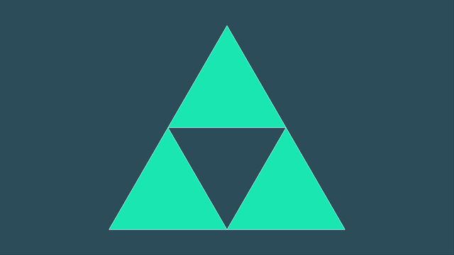

# 2-апта: вершина буферлері (VBO, VAO), үшбұрыштар

**Файл:** [`main.cpp`](main.cpp) · **Бағдарлама:** `cg_week02` · **Тег:** `week02`

Іске қосқанда бағдарлама консольде қатар санын сұрайды (1 — бір үшбұрыш, 2, 3, ... —
үшбұрыштардан тұратын пирамида). Скриншот — 2 қатар.

## Орындалған тапсырмалар

| № | Тапсырма | Кодта қай жерде |
|---|----------|-----------------|
| Базалық | VAO → VBO → `glBufferData` → `glVertexAttribPointer` → `glEnableVertexAttribArray` | «2-АПТА: үшбұрыштың деректері мен буферлері» бөлімі |
| 1 | Бір массивте бірнеше үшбұрыш | `fillVerts` — бір массив, `glDrawArrays(GL_TRIANGLES, 0, fillCount)` (вершина саны) |
| 2 | `GL_LINE_LOOP` | перне `2` (`1` — қайта `GL_TRIANGLES`) |
| 3 | Wireframe: `glPolygonMode(GL_FRONT_AND_BACK, GL_LINE)` | перне `W` (қосу/өшіру) |
| 4 | Түсті өзгерту | `FILL_COLOR` / `LINE_COLOR`, fragment шейдердегі `uColor` |

## Басқару

| Перне | Әрекет |
|-------|--------|
| 1 / 2 | `GL_TRIANGLES` / `GL_LINE_LOOP` |
| W     | wireframe қосу/өшіру |
| Space | ақ фон |
| Esc   | шығу |

## Қорғауға жауаптар

- **Екі үшбұрыш неге `GL_LINE_LOOP`-та бір фигураға айналады?** `GL_LINE_LOOP` барлық
  вершинаны ретімен бір тұйық сызыққа қосады — үшбұрыштарға бөлмейді. Сондықтан бұл кодта
  әр үшбұрыш бөлек `glDrawArrays(GL_LINE_LOOP, i * 3, 3)` шақыруымен сызылады.
  `GL_LINE_STRIP` дәл солай қосады, бірақ соңғы вершинаны біріншімен жалғамайды — контур ашық қалады.
- **Wireframe мен `GL_LINE_LOOP` айырмашылығы?** `GL_LINE_LOOP` — примитив түрін өзгертеді
  (сызық салынады). `glPolygonMode` примитивті өзгертпейді: үшбұрыштар үшбұрыш болып қалады,
  тек растеризация кезеңінде іші толтырылмай, әр үшбұрыштың шеті ғана салынады.
- **Неге бүкіл үшбұрыш бір түсті?** Түс fragment шейдерде бір тұрақты (`uColor`) — әр пиксельге
  бірдей. Әр бұрышты бөлек бояу үшін түсті вершинаның атрибуты ретінде беру керек
  (3-аптада жасалады), сонда GPU оны пиксельдер арасында интерполяциялайды.
