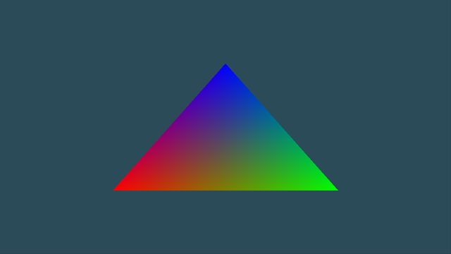
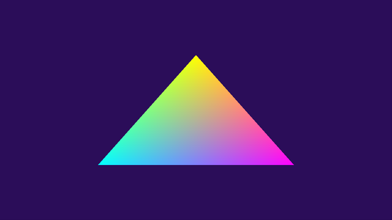
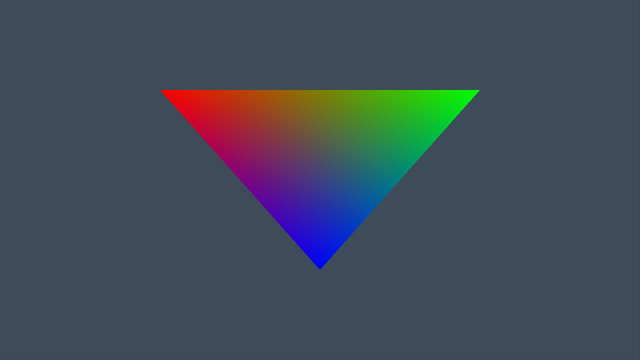
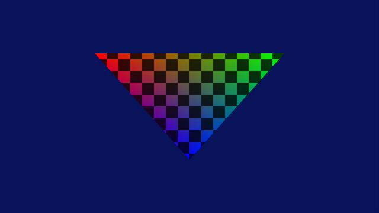

# 3-апта: шейдерлер, GLSL, интерполяция

**Файл:** [`main.cpp`](main.cpp) · **Бағдарлама:** `cg_week03` · **Тег:** `week03`



## Базалық бөлім

- **`makeShader()`** — компиляция мен линковка функцияға жиналды. Ішінде екі тексеру:
  `glGetShaderiv(..., GL_COMPILE_STATUS, ...)` (компиляция) және
  `glGetProgramiv(..., GL_LINK_STATUS, ...)` (линковка). Қате болса, мәтіні консольге шығады.
- **Түс атрибуты** — әр вершина 6 float (позиция + түс), `STRIDE = 6 * sizeof(float)`
  екі атрибутта да, түстің ығысуы `(void*)(3 * sizeof(float))`.

## Тапсырмалар

Бәрі бір бағдарламада, пернемен қосылады — қорғауда әрқайсысын бірден көрсетуге болады.

| № | Тапсырма | Перне | Нәтиже |
|---|----------|-------|--------|
| 1 | Түстерді төңкеру: `FragColor = vec4(1.0 - vColor, 1.0)` | `I` |  |
| 2 | Үш вершинаға бірдей түс (бөлек VAO) | `C` |  |
| 3 | `gl_Position.y *= -1.0` | `Y` |  |
| 4 | Әдейі қате жазу | `cg_week03 --broken` | төменде |
| Қосымша | Процедуралық шахмат: `gl_FragCoord`, `mod`, `step` | `P` |  |

Басқа пернелер: `W` — wireframe, `Space` — ақ фон, `Esc` — шығу.

## 4-тапсырма: әдейі қате

Қате шейдер кодта `fragmentBrokenSrc` деп тұр (`vec5` типі жоқ, жол соңында `;` жоқ).
Ол тек `--broken` аргументімен іске қосқанда компиляцияланады, сондықтан негізгі бағдарлама
қатесіз жұмыс істейді.

```
./build/bin/cg_week03 --broken
```

Консольдегі хабарлама (Mesa драйвері):

```
ШЕЙДЕР КОМПИЛЯЦИЯСЫНЫҢ ҚАТЕСІ (fragment):
0:6(7): error: syntax error, unexpected NEW_IDENTIFIER, expecting ',' or ';'

makeShader 0 қайтарды: тексеру жұмыс істейді, қате ұсталды.
```

Оқу: `0:6(7)` — 0-шейдер көзі, **6-жол**, 7-баған. Жолдар шейдер мәтінінен саналады
(`R"(` кейінгі бос жол — 1-жол, `#version` — 2-жол), C++ файлының жол нөмірі емес.
6-жол — `vec5 c = vec5(vColor, 1.0, 1.0)`: компилятор `vec5`-ті тип деп танымайды,
атау деп оқиды да, келесі `c` атауын күтпеген.
NVIDIA/AMD/Intel драйверлерінде мәтін басқаша болады, бірақ жол нөмірі бәрінде бар.

## Қорғауға жауаптар

- **Градиент қайда кетті (2-тапсырма)? Оны кім есептейді?** Градиентті vertex шейдер де,
  fragment шейдер де есептемейді — оны **растеризатор** (GPU-дағы бекітілген кезең) жасайды:
  `out vColor` мәнін үш вершинаның арасында әр пиксельге интерполяциялайды. Үш вершинаның түсі
  бірдей болса, интерполяция нәтижесі де бірдей — градиент жоғалады.
- **Неге дәл `gl_Position` экрандағы орынды анықтайды?** Бұл — кірістірілген шығыс айнымалы:
  конвейер вершинаның орнын тек одан алады (clip space → NDC → экран). Басқа айнымалыны
  өзгертсең (мысалы `vColor`), ол fragment шейдерге жай дерек болып барады — фигура қозғалмайды.
- **Неге `1.0 - vColor` үшін цикл керек емес?** GLSL-де векторлық амалдар покомпонентті:
  `1.0 - vec3` әр компонентке бөлек қолданылады.
