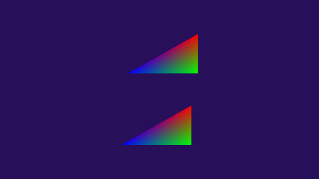
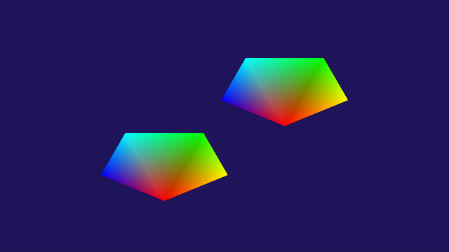
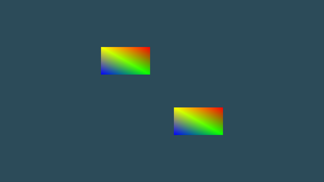

# 5-апта: индекс буфері (EBO), примитив түрлері

**Файл:** [`main.cpp`](main.cpp) · **Бағдарлама:** `cg_week05` · **Тег:** `week05`

Төртбұрыш 4 вершина мен 6 индекспен (`{0,1,3, 1,2,3}`) салынады:
`glDrawElements(GL_TRIANGLES, 6, GL_UNSIGNED_INT, 0)`. EBO VAO байланған кезде жасалады,
`GL_ELEMENT_ARRAY_BUFFER` босатылмайды, тазалауда `glDeleteBuffers` бар.
4-аптадағы орбита бойымен қозғалыс сақталған.

## Тапсырмалар

`T` пернесі фигураны ауыстырады: төртбұрыш → 1-тапсырма → 2-тапсырма → төртбұрыш.
Әр фигураның өз VAO/VBO/EBO-сы бар.

| № | Тапсырма | Қалай көрсету | Нәтиже |
|---|----------|---------------|--------|
| 1 | Индекстер `{0, 1, 2}`, `glDrawElements(..., 3, ...)` | `T` бір рет |  |
| 2 | Бесбұрыш: 5 вершина, 3 үшбұрыш, 9 индекс | `T` екі рет |  |
| 3 | Екі объект: бір `glBindVertexArray`, екі `glUniform2f` + `glDrawElements` | әрқашан |  |

Бесбұрыштың вершиналары (`x = cos(бұрыш) * 0.3`, `y = sin(бұрыш) * 0.3`):

| Вершина | Бұрыш | x | y | Орны |
|---------|-------|---|---|------|
| 0 | −90° | 0.0000 | −0.3000 | төменгі ұшы |
| 1 | −18° | 0.2853 | −0.0927 | оң, төменірек |
| 2 | 54° | 0.1763 | 0.2427 | оң жоғарғы |
| 3 | 126° | −0.1763 | 0.2427 | сол жоғарғы |
| 4 | 198° | −0.2853 | −0.0927 | сол, төменірек |

Үшбұрыштар: `(0,1,2)`, `(0,2,3)`, `(0,3,4)` — барлығы сағат тіліне қарсы. 0-вершина үшеуіне
ортақ: ол бүкіл бесбұрышты «желпуіш» сияқты бөледі, сондықтан ортасында тесік қалмайды.

## Басқару

| Перне | Әрекет |
|-------|--------|
| T     | фигура: төртбұрыш / `{0,1,2}` / бесбұрыш |
| W / S | айналу жылдамдығы |
| Q / E | орбита радиусы |
| R     | бастапқы күйге қайтару |
| F     | wireframe |
| 1 / 2 | `GL_TRIANGLES` / `GL_LINE_LOOP` |
| Space | ақ фон |
| Esc   | шығу |

## Қорғауға жауаптар

- **1-тапсырма: қай үшбұрыш жоғалды?** Екі бастапқы үшбұрыш та (`0,1,3` және `1,2,3`) жоғалды.
  Орнына `0-1-2` үшбұрышы салынды: оң жоғарғы, оң төменгі, сол төменгі — төртбұрыштың
  оң-төменгі жартысы. 3-вершина (сол жоғарғы) бірде-бір индексте жоқ, сондықтан ол қолданылмайды.
  **Вершина деректері өзгерген жоқ** — сол 4 вершина, тек индекстер басқа.
- **2-тапсырма: `GL_TRIANGLE_FAN` қолдансаң, индекс саны қанша?** 5: `0, 1, 2, 3, 4`.
  Желпуіште бірінші вершина барлық үшбұрышқа ортақ, әр келесі вершина бір жаңа үшбұрыш береді.
  `GL_TRIANGLES`-те 9 индекс керек болды.
- **3-тапсырма: екеуіне қанша байт дерек жіберілді? Геометрия қайта жіберілді ме?**
  Геометрия GPU-ға бір рет, бағдарлама басында жіберіледі: вершиналар 4 × 6 × 4 = 96 байт,
  индекстер 6 × 4 = 24 байт, барлығы 120 байт. Екінші объект үшін геометрия **қайта
  жіберілмейді** — әр кадрда тек `uOffset` uniform-ы (2 float = 8 байт) өзгереді.
- **Неге `glDrawElements`-тің екінші параметрі 6, 4 емес?** Ол — индекс саны, вершина саны емес.
