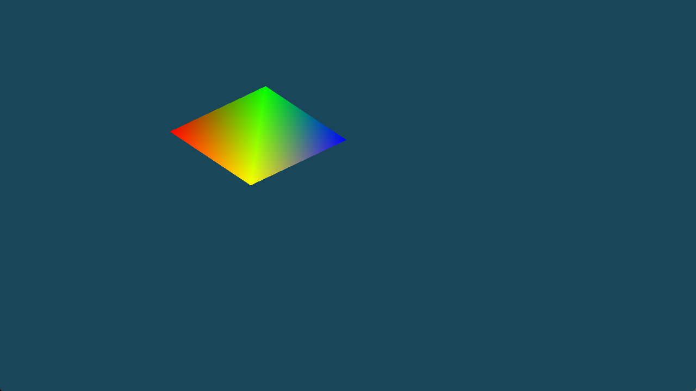
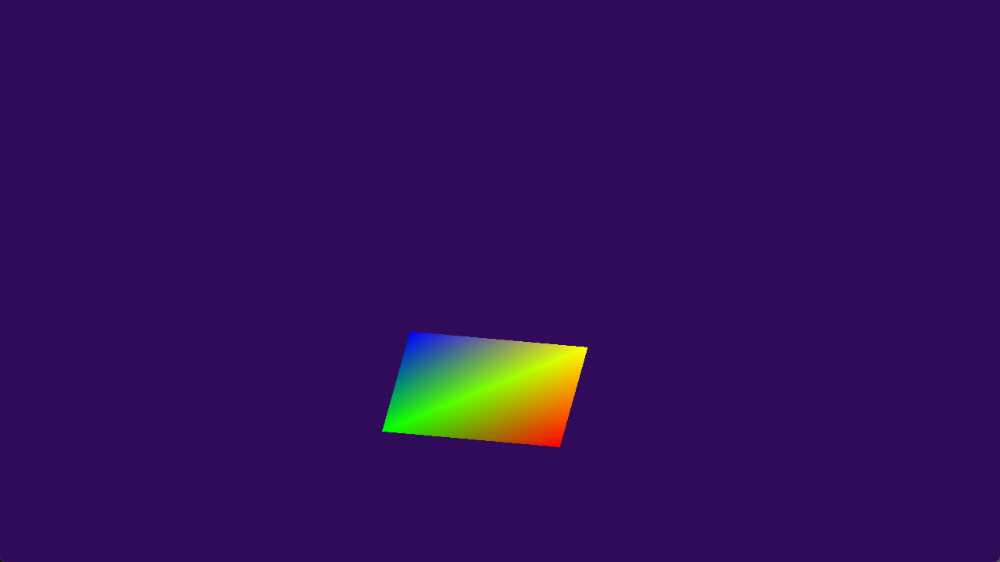
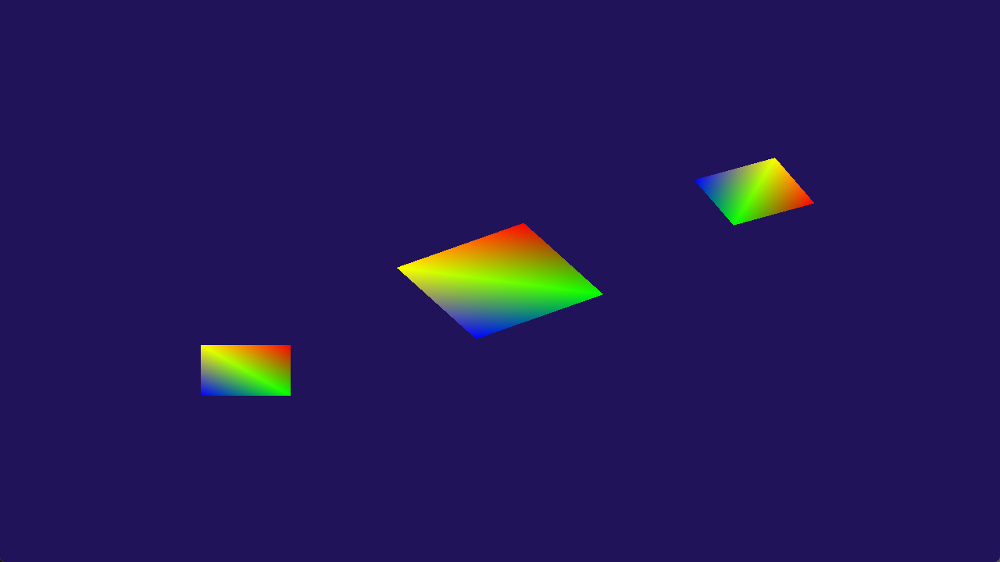
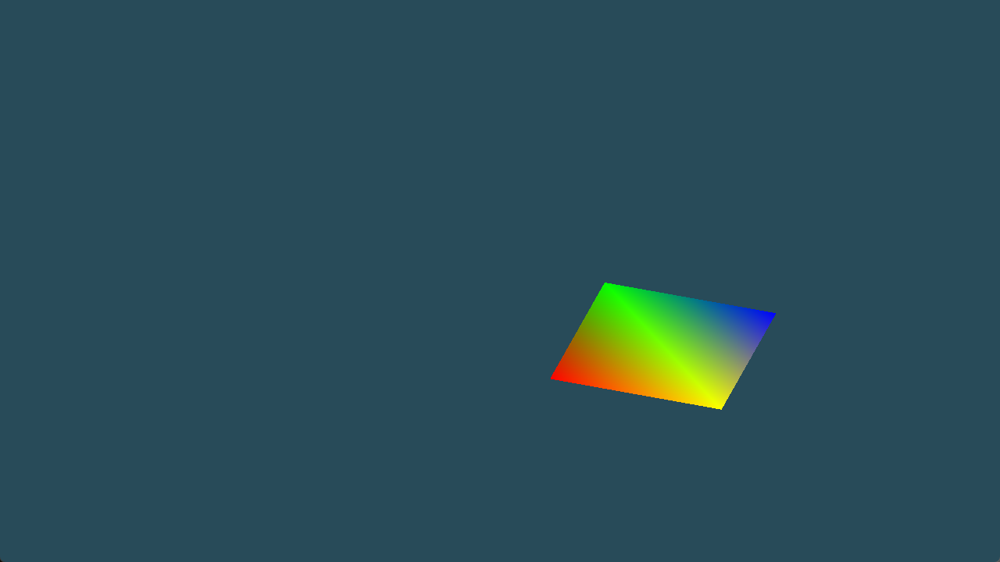

# 6-апта: түрлендіру матрицалары (GLM)

**Файл:** [`main.cpp`](main.cpp) · **Бағдарлама:** `cg_week06` · **Тег:** `week06`

Шейдердегі `uOffset` пен `uScale` алынды, орнына бір `uniform mat4 uTransform`:
`gl_Position = uTransform * vec4(aPos, 1.0)`. Матрица әр кадрда **цикл ішінде** GLM-мен
құрылады (`translate` → `rotate` → `scale`, яғни T · R · S) және
`glUniformMatrix4fv(locTransform, 1, GL_FALSE, glm::value_ptr(m))` арқылы жіберіледі.
Төртбұрыш шеңбер бойымен жүреді, әрі өз центрінен айналады.

GLM түбірдегі `CMakeLists.txt`-те бұрыннан қосылған (`FetchContent` + `glm::glm`).

## Тапсырмалар

`T` пернесі режимді ауыстырады: негізгі → 1 → 2 → 3-тапсырма → негізгі.
Барлық режимде бір VAO, тек матрица өзгереді.

| № | Тапсырма | Қалай көрсету | Нәтиже |
|---|----------|---------------|--------|
| — | Негізгі: T · R · S, орбита + өз центрінен айналу | бастапқы күй |  |
| 1 | `translate` пен `rotate` орнын ауыстыру (R · T · S) | `T` бір рет |  |
| 2 | Сол төменгі бұрыштан айналу | `T` екі рет |  |
| 3 | Үш төртбұрыш: бір VAO, үш матрица, үш сызу | `T` үш рет |  |

### 2-тапсырма: үш қадам

Сол төменгі бұрыш — `(-0.3, -0.3)`. Кодта соңғы жазылған функция вершинаға бірінші әсер етеді:

```cpp
m = glm::scale(m, glm::vec3(0.6f, 0.6f, 1.0f));
m = glm::translate(m, glm::vec3(-0.3f, -0.3f, 0.0f));    // 3) кері қайтару
m = glm::rotate(m, angle, glm::vec3(0.0f, 0.0f, 1.0f));  // 2) бұру
m = glm::translate(m, glm::vec3(0.3f, 0.3f, 0.0f));      // 1) бұрышты (0,0)-ге апару
```

Бұрыш бір орында тұрады (экранда `(-0.18, -0.18)`), төртбұрыш оны айнала бұрылады.

### 3-тапсырма: үш матрица

| Төртбұрыш | Орны | Айналу | Масштаб |
|-----------|------|--------|---------|
| 1 | ортада | өз центрінен, `angle` | 0.5 |
| 2 | орбита, радиус 0.6 | кері бағытта, `-2 · angle` | 0.3 |
| 3 | орбитаның қарсы жағы (`angle + π`) | жоқ | 0.3 |

## Басқару

| Перне | Әрекет |
|-------|--------|
| T     | режим: негізгі / 1 / 2 / 3-тапсырма |
| W / S | айналу жылдамдығы |
| Q / E | орбита радиусы (негізгі және 1-режимде) |
| R     | бастапқы күйге қайтару |
| F     | wireframe |
| 1 / 2 | `GL_TRIANGLES` / `GL_LINE_LOOP` |
| Space | ақ фон |
| Esc   | шығу |

## Қорғауға жауаптар

- **1-тапсырма: траектория неге өзгерді?** Матрицалар коммутативті емес: `T · R ≠ R · T`.
  Негізгі режимде (T · R · S) төртбұрыш алдымен өз центрінен бұрылады, сосын орбитаға
  жылжиды — орны `(cos a, sin a) · радиус`. Орын ауыстырғанда (R · T · S) алдымен жылжиды,
  сосын **бүкіл координаталар жүйесі экран центрінен** бұрылады — жылжыту векторының өзі де
  `a`-ға бұрылады. Нәтижесінде орны `(cos 2a, sin 2a) · радиус`: шеңбер сол, бірақ төртбұрыш
  оны **екі есе жылдам** айналады. Өз бұрылуы бұрынғыдай `a`, сондықтан ол енді центрге
  бір жағымен қарап тұрмайды.
- **Неге `glm::mat4(1.0f)`?** Бұл бірлік матрица (диагональда 1, қалғаны 0), «бәрі 1» емес.
- **Неге матрица цикл ішінде жарияланады?** Сыртта болса, әр кадрда жаңа түрлендіру
  алдыңғысының үстіне көбейтіледі — фигура бірнеше кадрда экраннан кетеді.
- **Неге `GL_FALSE`?** GLM матрицаны бағаналап (column-major) сақтайды, OpenGL да солай күтеді.
  `GL_TRUE` болса матрица транспонирленеді де, жылжыту бұзылады.
- **Неге `glm::value_ptr(m)`, `&m` емес?** `glm::mat4` — құрылым; оның адресі бірінші float-тың
  адресі болатынына стандарт кепілдік бермейді. `value_ptr` дәл `float*` қайтарады.
- **Неге 0.6?** Бұрыштар ±0.3 → ±0.18, центрден ең алыс нүкте 0.18 · √2 ≈ 0.25.
  Орбита 0.4 + 0.25 = 0.65 < 1.0 — NDC-ден шықпайды.
- **Радиан:** `glm::rotate` радиан қабылдайды. Тұрақты бұрышқа `glm::radians(45.0f)` керек.
