# 7-апта: координаттар кеңістіктері, MVP, проекция

**Файл:** [`main.cpp`](main.cpp) · **Бағдарлама:** `cg_week07` · **Тег:** `week07`

Төртбұрыштың орнына **куб**: 36 вершина, әрқайсысы 6 float (позиция + түс), әр қырдың өз түсі.
Шейдердегі бір `uTransform` орнына үш матрица:
`gl_Position = uProjection * uView * uModel * vec4(aPos, 1.0)`.
Матрицалар цикл ішінде құрылады: `glm::perspective` (fov 45°, aspect терезеден, near 0.1, far 100),
`glm::lookAt` (камера `(0, 0, 3)`-те, координат басына қарайды), `glm::rotate` (Y осі).
Сызу — `glDrawArrays(GL_TRIANGLES, 0, 36)`, EBO жоқ.

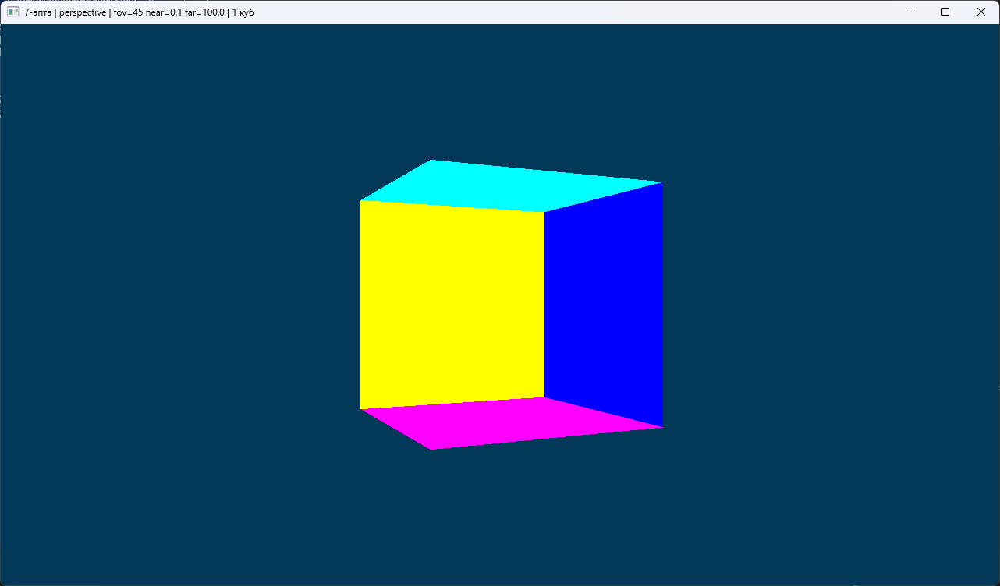

> Куб «ішінен тысқа айналған» сияқты көрінеді — артқы қырлар алдыңғысын жауып тұрады.
> Бұл қате емес: тереңдік тесті әлі қосылмаған, 8-аптада қосылады.

## Базалық бөлім

| № | Не жасалды | Кодта қай жерде |
|---|------------|-----------------|
| 1 | Куб: 36 вершина, 6 қыр × 2 үшбұрыш × 3 вершина, әр қыр сырттан CCW | `vertices[]` |
| 2 | Үш uniform: `uModel`, `uView`, `uProjection` | `vertexSrc` |
| 3 | Терезе өлшемі жаһандық `gWidth`, `gHeight`-та | `framebuffer_size_callback` |
| 4 | Үш uniform орны цикл алдында бір рет табылады | `locModel`, `locView`, `locProj` |
| 5 | Үш матрица цикл ішінде | «7-АПТА: цикл ішінде үш матрица» бөлімі |
| 6 | `glDrawArrays(GL_TRIANGLES, 0, 36)` | цикл соңы |

Терезе тақырыбында қазіргі параметрлер жазылады: проекция түрі, fov, near, far, куб саны.

## 1-тапсырма: проекция параметрлерін зерттеу

`1` — fov (30 → 45 → 90 → 120), `2` — near (0.1 → 1.0 → 2.5 → 4.0), `3` — far (100 → 5 → 2).
`R` — бәрін 45 / 0.1 / 100-ге қайтарады. Қалған екі параметр әдепкі мәнде.

Камера `z = 3`-те, куб координат басында. Куб Y осінен айналғанда бұрыштары центрден
`0.5 · √2 ≈ 0.71` қашықтыққа шығады, сондықтан кубтың нүктелері камерадан **2.29 … 3.71** бірлік
қашықтықта болады.

| Параметр | Нәтиже | Скриншот |
|----------|--------|----------|
| fov = 30° | Куб үлкейді, экранның көп бөлігін алады | 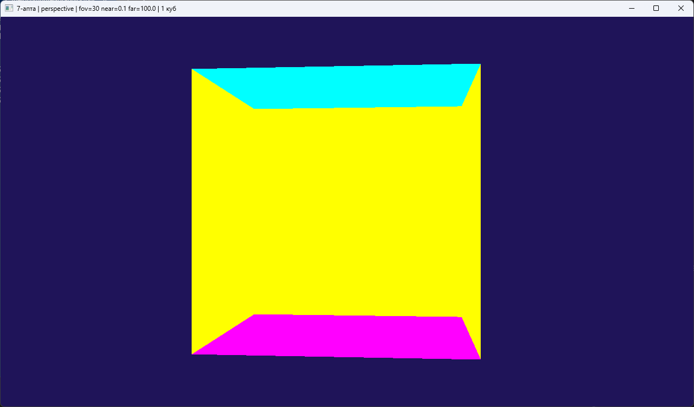 |
| fov = 45° | Әдепкі көрініс |  |
| fov = 90° | Куб кішірейді | 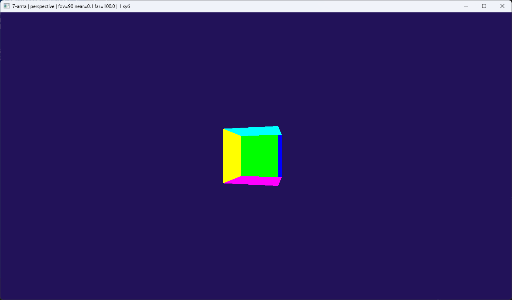 |
| fov = 120° | Куб өте кішкентай, перспектива бұрмалауы күшті | 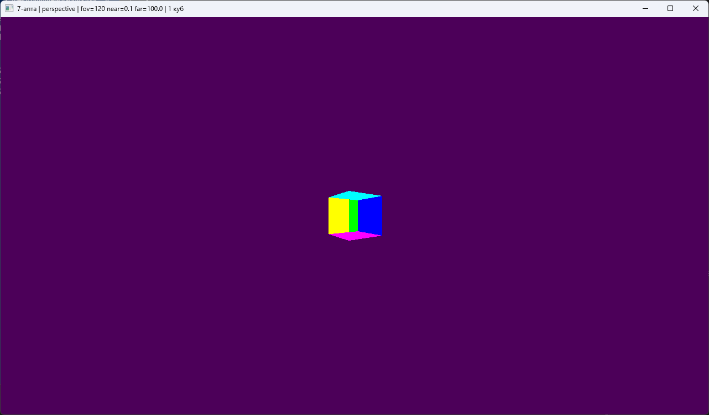 |
| near = 1.0 | Өзгеріс жоқ — куб 2.29-дан алыс | 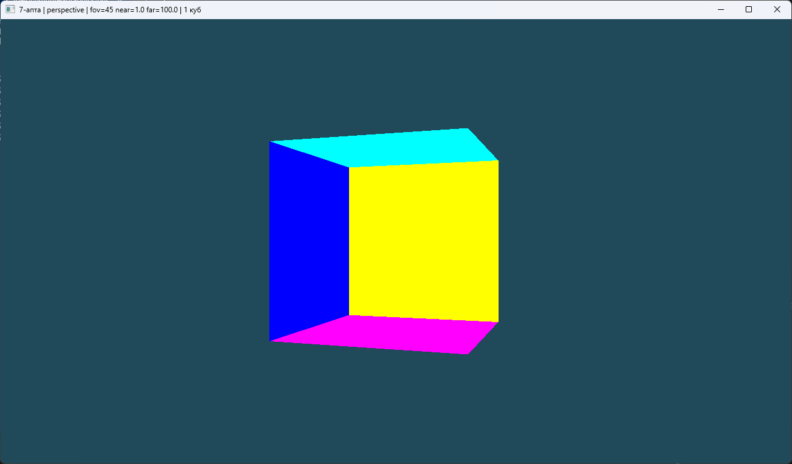 |
| near = 2.5 | Камераға жақындаған бұрышы кесіледі (2.29 < 2.5) | 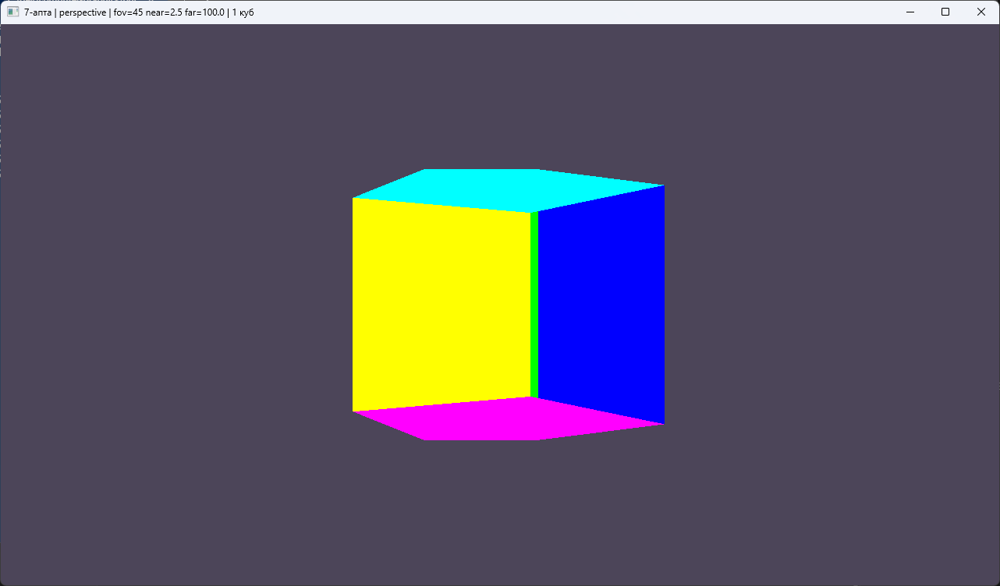 |
| near = 4.0 | **Куб жоғалды** — бүкіл куб near жазықтығының алдында | 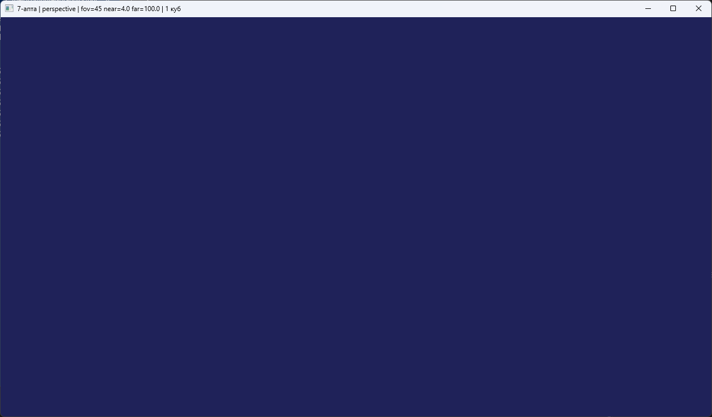 |
| far = 5.0 | Өзгеріс жоқ — куб 3.71-ден жақын | 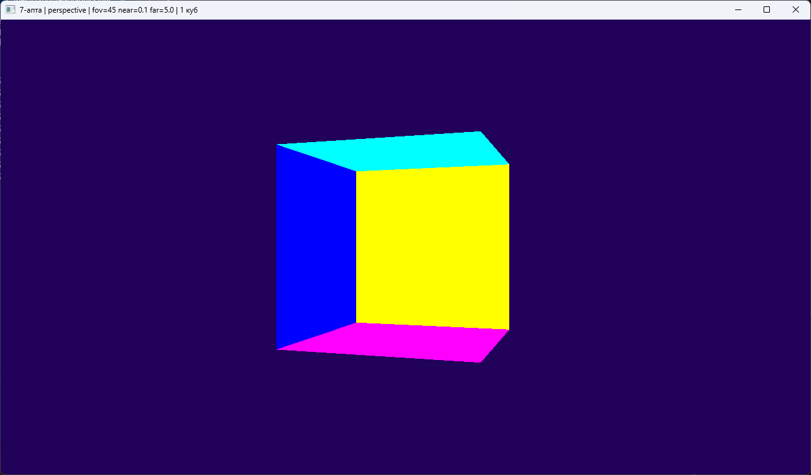 |
| far = 2.0 | **Куб жоғалды** — бүкіл куб far жазықтығының артында | 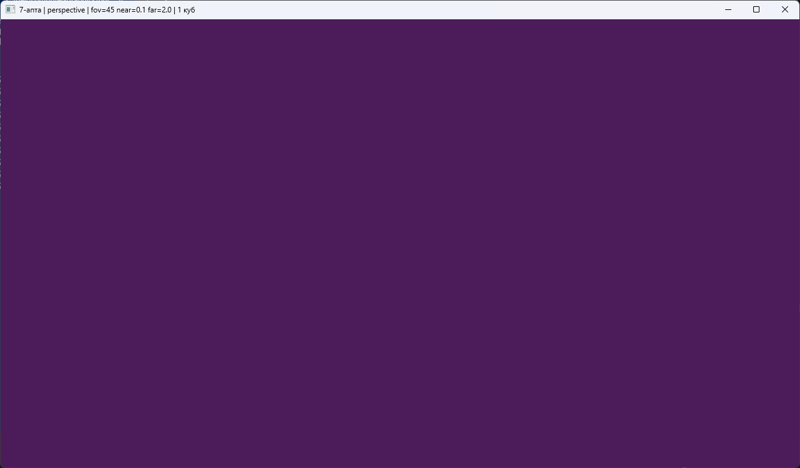 |

Куб толық жоғалатын жағдайлар: `near = 4.0` және `far = 2.0`. `near = 2.5` кезінде куб толық
жоғалмайды — тек камераға бұрылған бұрышы мен қырлары кесіледі.

## 2-тапсырма: ортографияға ауысу

`O` пернесі `glm::perspective` орнына `glm::ortho(-a, a, -1.0f, 1.0f, 0.1f, 100.0f)` қояды
(`a = gWidth / gHeight`).

| Перспектива | Ортография |
|-------------|------------|
|  | 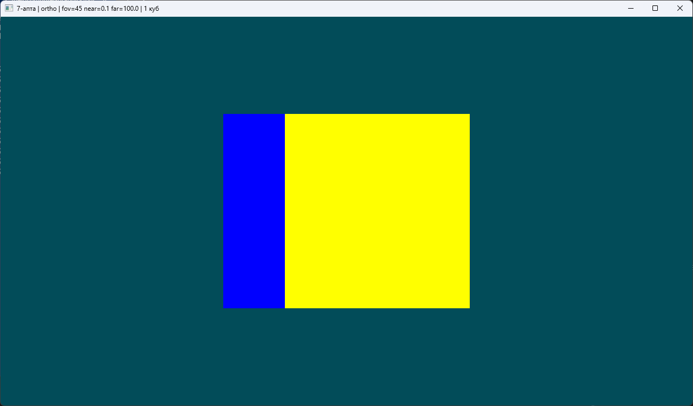 |

Айырмашылық: перспективада жақын қыр үлкен, алыс қыр кіші, бүйір қырлар трапеция болып
көрінеді. Ортографияда жақын мен алыс қыр бірдей өлшемде — бүйір қырлар тік төртбұрыш,
кубтың тереңдігі «жоғалады».

## 3-тапсырма: үш куб

`T` пернесі — бір куб / үш куб. Бір геометрия, бір `glBindVertexArray`, цикл ішінде үш рет
«матрица құру → `glUniformMatrix4fv(locModel, ...)` → `glDrawArrays`». `projection` мен `view`
үшеуіне ортақ, циклдің сыртында бір рет жіберіледі.

| Куб | Орны | Айналу жылдамдығы |
|-----|------|-------------------|
| 1 | `(-1.5, 0, 0)` | `angle · 1.0` |
| 2 | `( 0.0, 0, -1)` | `angle · 0.5` |
| 3 | `( 1.5, 0, 0)` | `angle · 2.0` |

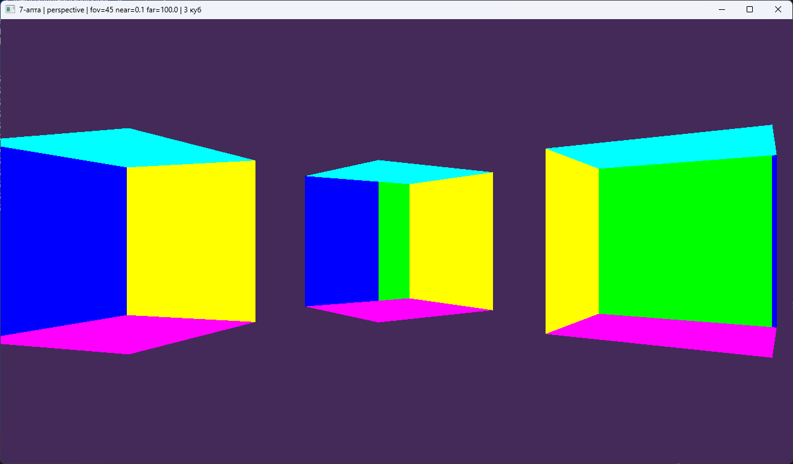

## Қосымша (міндетті емес)

| Не | Перне | Күйі |
|----|-------|------|
| Тінтуір дөңгелегімен fov (10°–90°) | дөңгелек | жасалды, `scroll_callback` |
| Wireframe | `Tab` | жасалды — артқы қырлар алдыңғылардың үстінен сызылғаны көрінеді |
| Пульсация (масштаб 0.8 … 1.2) | `P` | жасалды |
| Екі ось: Y және X осінен бірге айналу | `X` | жасалды |
| 24 вершина + EBO | — | жасалмады, есебі төменде |

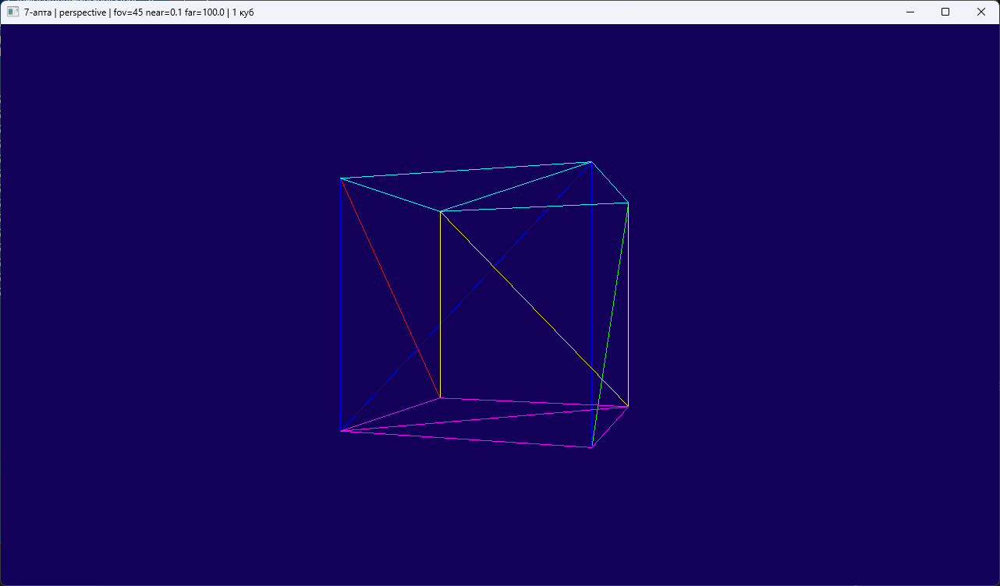

**24 вершина + EBO есебі.** Қазір: 36 × 6 × 4 байт = 864 байт. EBO-мен: 24 × 6 × 4 = 576 байт
вершина + 36 × 4 = 144 байт индекс = 720 байт. Вершина саны 33%-ға азаяды, жалпы көлем ~17%-ға.

## Басқару

| Перне | Әрекет |
|-------|--------|
| 1 / 2 / 3 | fov / near / far мәндерін кезекпен ауыстыру |
| O     | перспектива / ортография |
| T     | бір куб / үш куб |
| Tab   | wireframe |
| X     | екі осьтен айналу |
| P     | пульсация |
| Дөңгелек | fov 10°–90° |
| W / S | айналу жылдамдығы |
| R     | бастапқы күйге қайтару |
| Space | ақ фон |
| Esc   | шығу |

## Қорғауға жауаптар

- **Неге 36 вершина, 8 емес?** Кубтың бұрышы үш қырға ортақ, ал ол үш қырдың түсі үшеуі үш басқа.
  Бір вершина үш түрлі түс ұстай алмайды, сондықтан әр қырдың өз вершиналары бар:
  6 қыр × 2 үшбұрыш × 3 вершина = 36.
- **Неге ретті `uProjection * uView * uModel`?** Матрицалар оңнан солға қарай әсер етеді:
  алдымен model (объектіні әлемге қою), сосын view (камераға қатысты), соңында projection (экранға).
- **fov үлкейгенде куб неге кішірейеді?** fov — көру бұрышы. Бұрыш үлкен болса, экранға
  әлемнің үлкенірек бөлігі сыяды, ал экран өлшемі сол күйі — сондықтан әр объект кішірек.
- **`near = 4.0` болғанда не болды, неге?** Куб жоғалды. Кубтың ең алыс нүктесі камерадан 3.71,
  ал near-дан жақын нүктелердің бәрі кесіледі — куб толығымен near жазықтығының алдында.
- **Ортографияда `w` неге тең?** Әрқашан 1. Перспективада `w = -z` (тереңдікке тәуелді),
  `x / w` бөлу алыс объектіні кішірейтеді. Ортографияда бөлу ештеңе өзгертпейді — өлшем
  қашықтыққа тәуелді емес.
- **Ортадағы куб неге кішірек көрінеді?** Ол `z = -1`-де тұр, яғни камерадан 4 бірлік, ал шеттегі
  кубтар 3 бірлікте. Перспективада алыс объект кішірек.
- **`view` матрицасы әр кубқа бөлек есептеле ме?** Жоқ. Камера біреу, сондықтан `view` (және
  `projection`) кадрға бір рет құрылып, циклдің сыртында бір рет жіберіледі. Тек `model` әр кубта бөлек.
- **Неге айналу осі `(0, 1, 0)`?** Z осінен айналса, кубтың барлық нүктесі камерадан бірдей
  қашықтықта қалады — перспектива мүлде көрінбейді.
- **Жиі кететін қателер:** aspect `800.0f/600.0f` деп жазылса — терезені созғанда куб бұзылады;
  `glDrawArrays`-та 6 қалса — бір қыр ғана сызылады; матрицалар цикл сыртында құрылса — куб
  қозғалмайды; near 0 болса — экран толық қара.
