# 8-апта: тереңдік буфері, back-face culling, бірнеше объект

**Файл:** [`main.cpp`](main.cpp) · **Бағдарлама:** `cg_week08` · **Тег:** `week08`

7-аптадағы куб енді **дұрыс көрінеді**, әрі экранда бес куб тұр. Жаңа код аз — төрт жол:

```cpp
glEnable(GL_DEPTH_TEST);                               // циклге дейін
glClear(GL_COLOR_BUFFER_BIT | GL_DEPTH_BUFFER_BIT);    // цикл ішінде, әр кадрда
glEnable(GL_CULL_FACE); glCullFace(GL_BACK); glFrontFace(GL_CCW);   // циклге дейін
```

Қалғаны — бес кубтың циклі: `projection` мен `view` бір рет, `model` әр кубқа бөлек,
**цикл ішінде** `glm::mat4(1.0f)`-ден басталады.

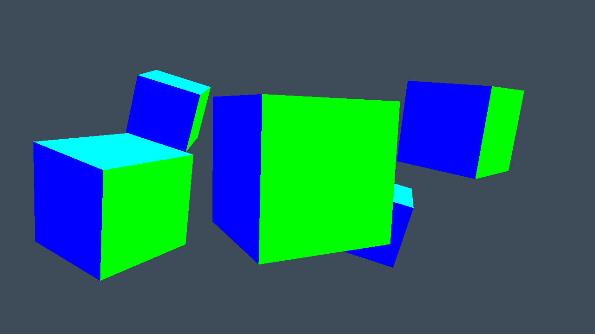

Іске қосқанда консольге тереңдік буферінің разряды шығады: `depth bits: 24`.

## Базалық бөлім

| № | Не жасалды | Кодта қай жерде |
|---|------------|-----------------|
| 1 | Тереңдік тесті | `glEnable(GL_DEPTH_TEST)` — циклге дейін |
| 2 | Тереңдік буферін тазалау | `glClear(... \| GL_DEPTH_BUFFER_BIT)` — цикл ішінде |
| 3 | Culling: `GL_BACK`, `GL_CCW` | циклге дейін |
| 4 | Бес кубтың позициялары | `positions[]` |
| 5 | Сызу циклі: P мен V бір рет, M әрқайсысына | `for (int i = 0; i < 5; i++)` |

## 1-тапсырма: тереңдік тесінсіз және тесімен

`1` пернесі тереңдік тестін өшіреді/қосады (`glDisable` / `glEnable(GL_DEPTH_TEST)`).

| Тесімен | Тесінсіз |
|---------|----------|
|  | 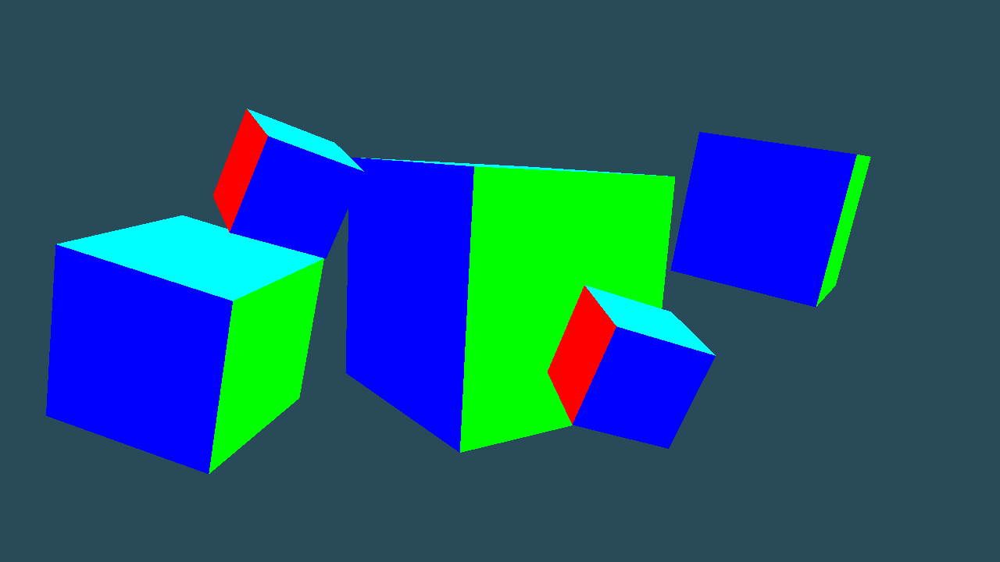 |

Тесінсіз кубтар бірін-бірі дұрыс жаппайды: артта тұрған кіші куб (`positions[3]`, `z = -3.5`)
алдыңғы үлкен кубтың **үстіне** сызылған. Culling қосулы болғандықтан кубтың өз артқы қырлары
бәрібір тасталады — қате кубтар арасында көрінеді.

## 2-тапсырма: Z-fighting жасау және жою

`2` пернесі Z-fighting сахнасын қосады: `near = 0.0001`, `far = 1000`, екі куб бетпе-бет,
екеуінің `z`-і **0.001**-ге ғана айырылады (екіншісі 180° бұрылған — алдына қызыл қыры шығады,
жыпылықтау түстен көрінсін). `3` пернесі near-ды 0.0001 ↔ 0.1 ауыстырады.

| near = 0.0001 | Біраздан кейін (өрнек өзгерді) | near = 0.1 — түзелді |
|---------------|-------------------------------|---------------------|
| 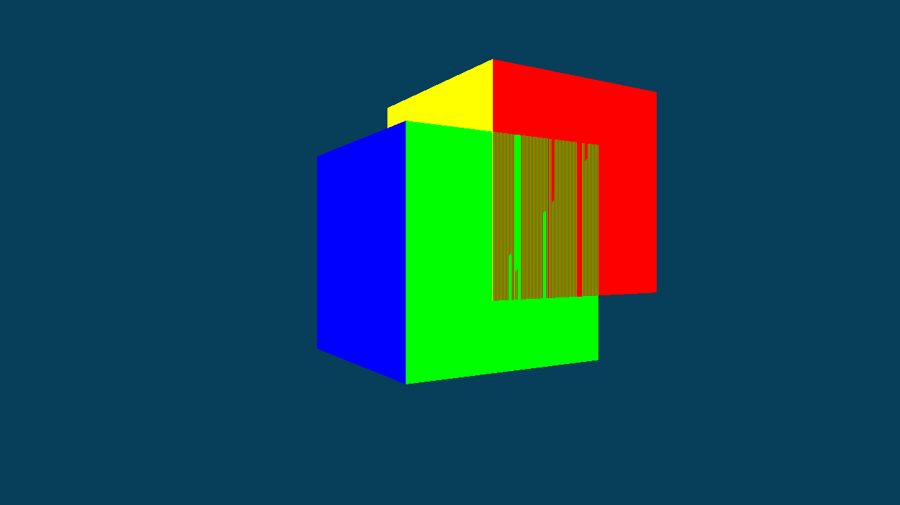 | 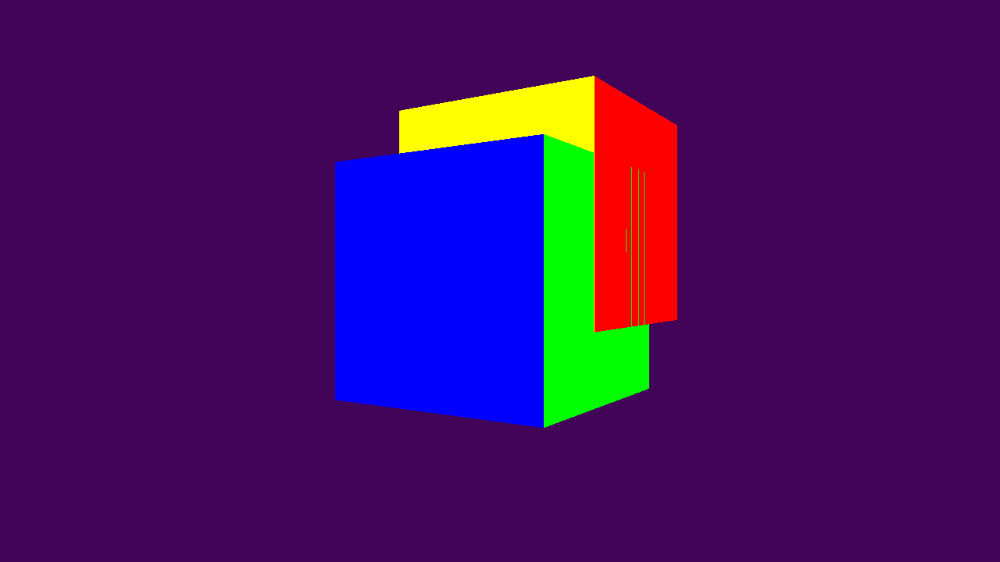 | 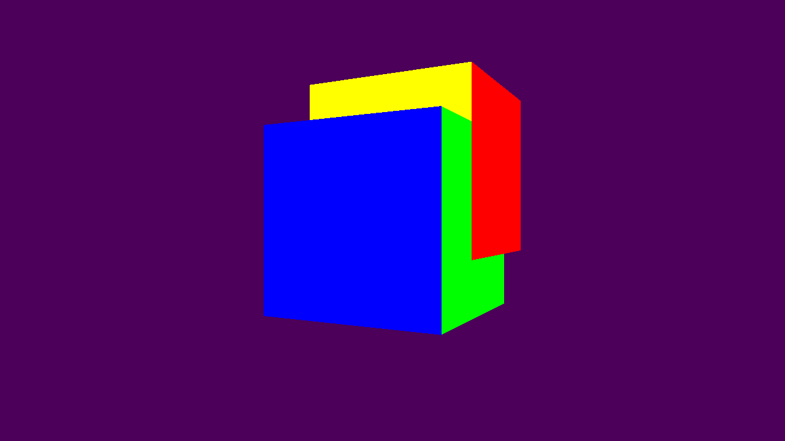 |

Тереңдік дәлдігінің бағасы: `Δz ≈ d² / (near · 2²⁴)`. `d = 3` болғанда:
`near = 0.0001` → `Δz ≈ 0.005` (0.001-ден үлкен — беттер ажырамайды);
`near = 0.1` → `Δz ≈ 0.000005` (жеткілікті).

## 3-тапсырма: culling тексеру

`4` пернесі `glCullFace(GL_BACK)` ↔ `glCullFace(GL_FRONT)` ауыстырады.

| `GL_BACK` — алты қыр да дұрыс | `GL_FRONT` — кубтың іші көрінеді |
|------------------------------|----------------------------------|
| 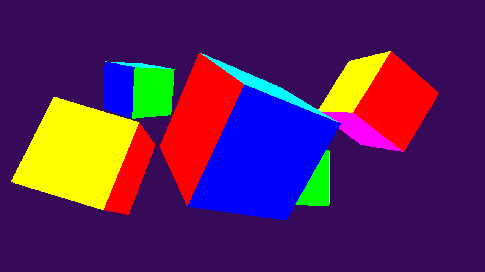 | 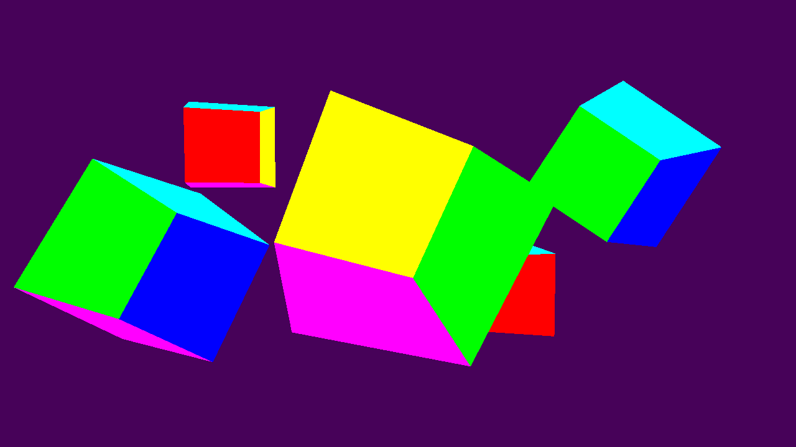 |

`GL_BACK` кезінде бірде-бір қыр жоғалмайды — вершиналар реті дұрыс (барлық қыр сырттан CCW).
`GL_FRONT` кезінде алдыңғы қырлар тасталып, кубтың ішкі (артқы) қырлары көрінеді.

## Қосымша (міндетті емес)

| Не | Перне | Нәтиже |
|----|-------|--------|
| `glDepthFunc(GL_GREATER)` | `5` |  |
| `glDepthFunc(GL_ALWAYS)` | `5` тағы | 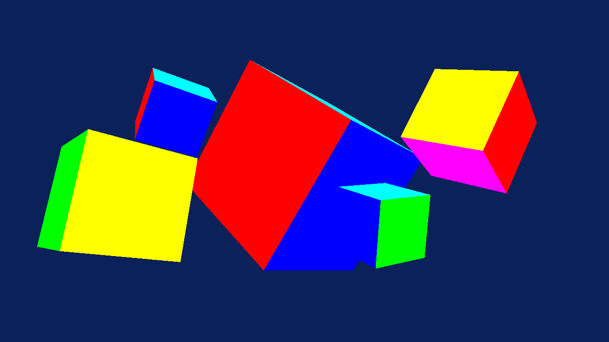 |
| Он куб шеңбер бойымен, әрқайсысы өз жылдамдығымен | `6` | 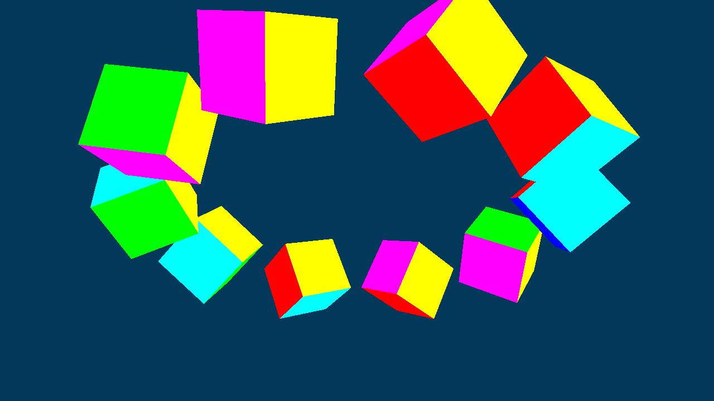 |
| Wireframe + culling | `Tab` | 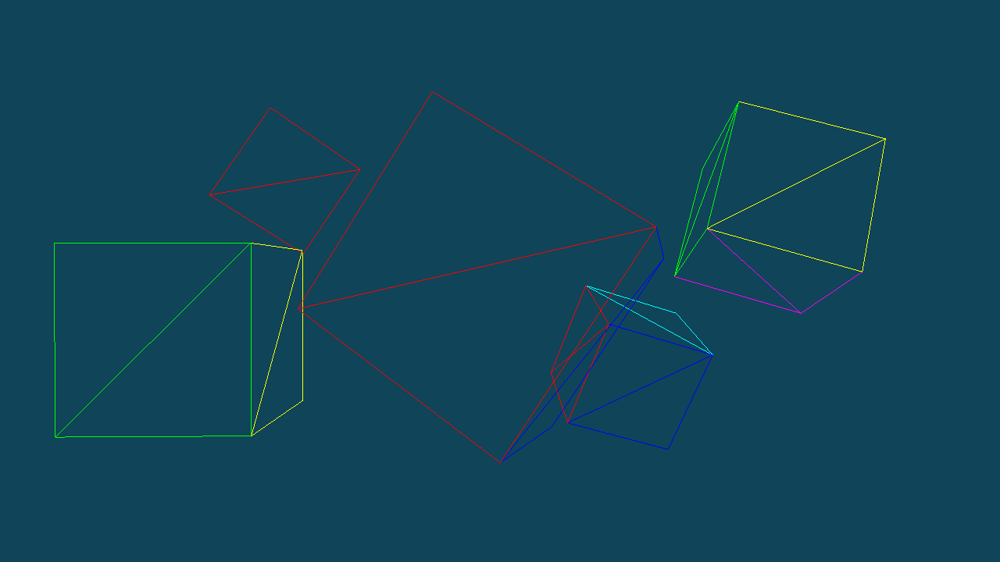 |
| Жазық фигура (кубтың алдыңғы қыры ғана) | `7` | 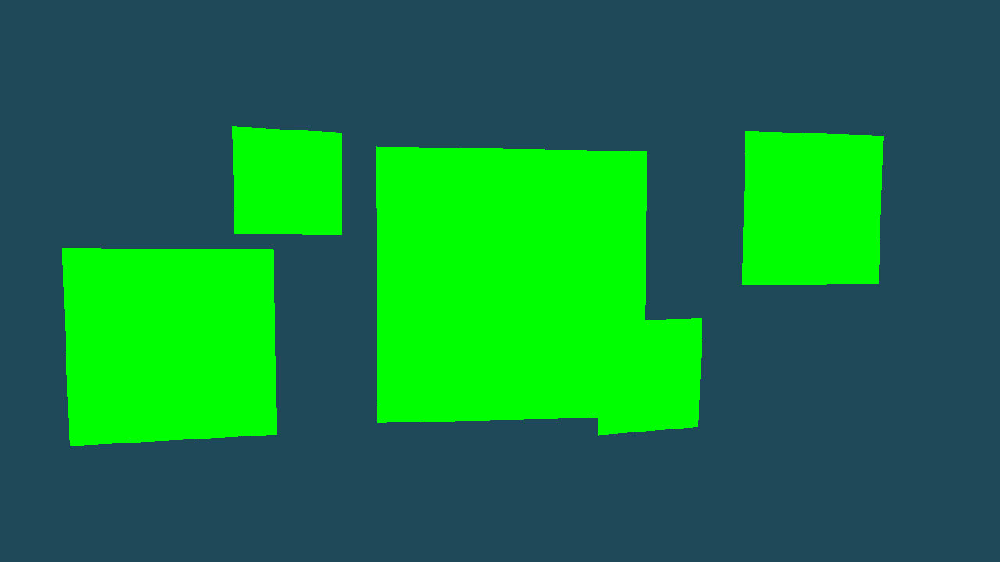 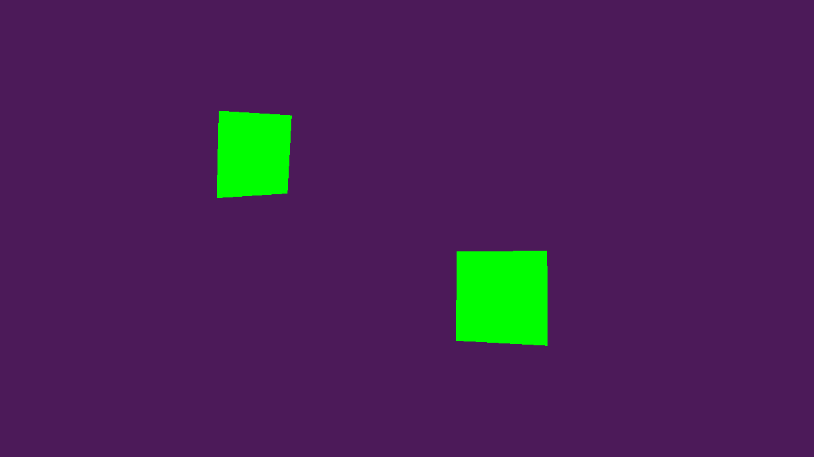 |
| Тереңдікті көзбен көру (`gl_FragCoord.z`) | `8` | 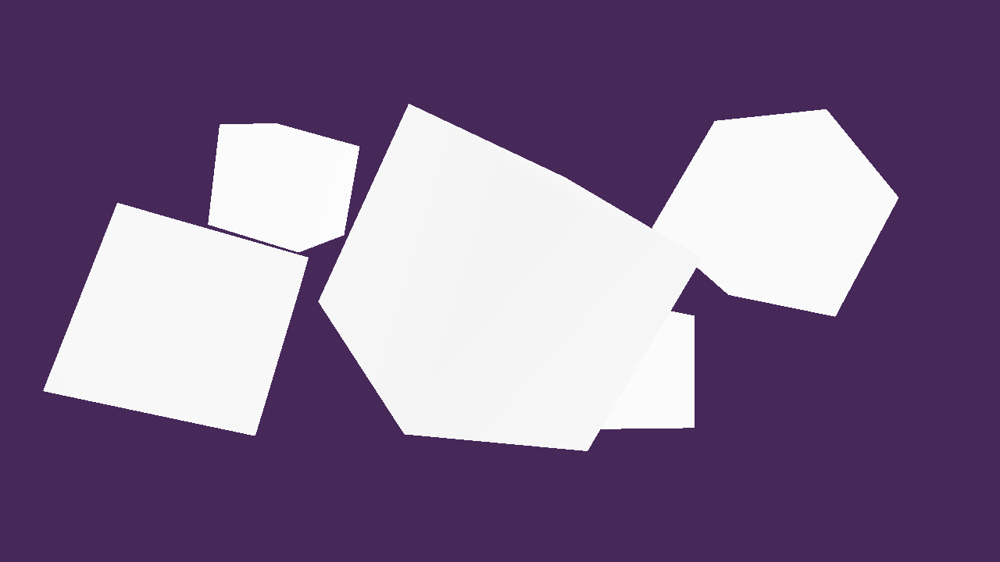 |

- **`GL_GREATER`** — ештеңе сызылмайды. Буфер 1.0-ге тазаланады, ал 1.0-ден үлкен тереңдік жоқ.
- **`GL_ALWAYS`** — тест әрқашан өтеді, яғни тереңдік тесті жоқтағыдай: соңғы сызылған алда.
- **Wireframe + culling** — тасталған үшбұрыштардың шеттері де сызылмайды, артқы сызықтар жоқ.
- **Жазық фигура** — бір жағынан ғана көрінеді: айналып, арқасымен бұрылғанда culling оны тастайды.
- **Тереңдік** — барлығы ақ дерлік. `near = 0.1`, `far = 100` кезінде `d = 3` нүктесінің
  тереңдігі ≈ 0.968: тереңдік сызықтық емес, буфердің көп бөлігі камераның жанында жұмсалады.

## Басқару

| Перне | Әрекет |
|-------|--------|
| 1 | тереңдік тесті қосу/өшіру |
| 2 | Z-fighting сахнасы |
| 3 | near: 0.0001 / 0.1 (Z-fighting сахнасында) |
| 4 | `GL_BACK` / `GL_FRONT` |
| 5 | `glDepthFunc`: `GL_LESS` → `GL_GREATER` → `GL_ALWAYS` |
| 6 | он куб |
| 7 | жазық фигура |
| 8 | тереңдікті көру |
| Tab | wireframe |
| Дөңгелек | fov 10°–90° |
| W / S | айналу жылдамдығы |
| R | бастапқы күйге қайтару |
| Space | ақ фон |
| Esc | шығу |

## Қорғауға жауаптар

- **Тесінсіз нұсқада қай куб алда көрінеді? Неге?** Соңғы сызылғаны. Тереңдік тесті жоқта
  әр жаңа фрагмент буферде тұрғанның үстіне жай жазылады — «кім кейін, сол алда».
  Сызу ретін өзгертсең, нәтиже де өзгереді.
- **Неге `GL_DEPTH_BUFFER_BIT` әр кадрда?** Тазаланбаса, буферде алдыңғы кадрдың тереңдіктері
  қалады, жаңа фрагменттер тесттен өтпейді — бірінші кадрдан кейін экран қатып қалады.
- **far-ды 1000-нан 100-ге түсірсең, жыпылықтау азая ма?** Аз ғана. Дәлдік `near`-ға тәуелді:
  буфердің жартысы `near` пен `2 · near` арасында жұмсалады. `far ≫ near` болса, far-ды
  өзгерткеннен мәндер іс жүзінде өзгермейді — сондықтан «far-ды кішірейту көмектеспейді».
- **Culling қосылғанда неше үшбұрыш растарланбай қалды?** Әр кубта 12 үшбұрыштың шамамен
  жартысы (6) — камераға арқасымен тұрғандары. Бес кубта ~30 үшбұрыш.
- **Куб айналғанда «артқы» қыр қалай ауысады — код өзгере ме?** Жоқ. OpenGL әр кадрда
  үшбұрыштың экрандағы айналу бағытын тексереді: камераға бұрылған қыр экранда CCW,
  арқасымен тұрған қыр CW болып көрінеді. Код өзгермейді.
- **Неге `model` цикл ішінде?** Сыртта болса, түрлендірулер кубтан кубқа үстемеленеді,
  кубтар ұшып кетеді.
