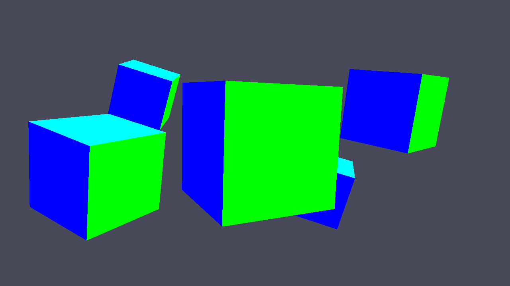
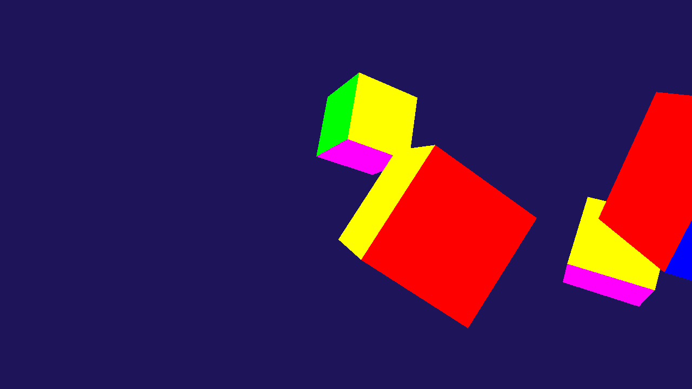
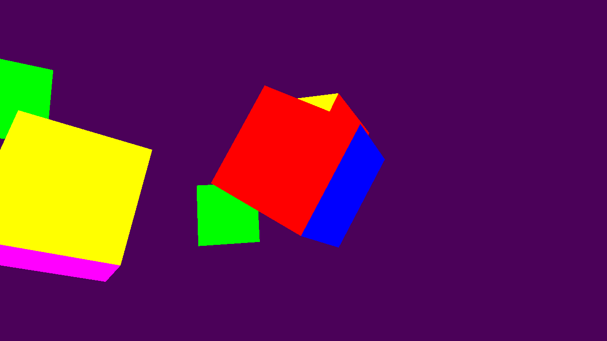
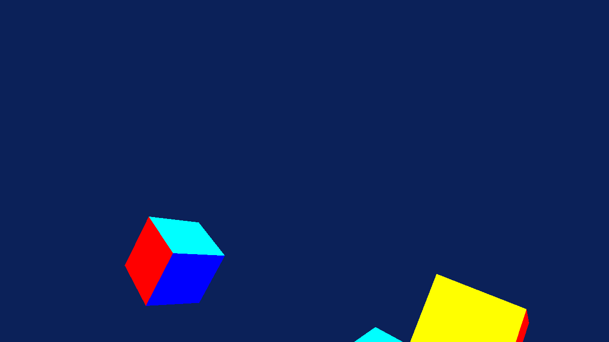
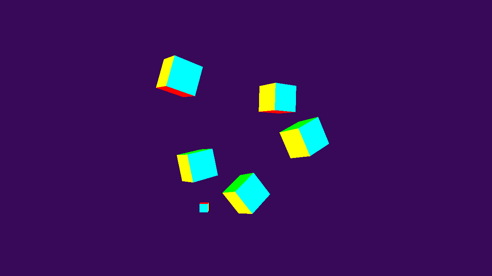

# 9-апта: камера моделі, LookAt, пернетақтамен жылжу

**Файл:** [`main.cpp`](main.cpp) · **Бағдарлама:** `cg_week09` · **Тег:** `week09`

Сахна өзгерген жоқ — сол бес куб. Бірақ енді **олардың арасында жүруге болады**.

```cpp
glm::vec3 camPos   = glm::vec3(0.0f, 0.0f,  3.0f);   // қайда тұр
glm::vec3 camFront = glm::vec3(0.0f, 0.0f, -1.0f);   // қайда қарайды
glm::vec3 camUp    = glm::vec3(0.0f, 1.0f,  0.0f);   // төбесі қай жақта

glm::mat4 view = glm::lookAt(camPos, camPos + camFront, camUp);
```

7-аптадағы тұрақты `lookAt(vec3(0,0,3), vec3(0,0,0), vec3(0,1,0))` жойылды.



## Базалық бөлім

| № | Не жасалды | Кодта қай жерде |
|---|------------|-----------------|
| 1 | `camPos`, `camFront`, `camUp` — жаһандық, цикл сыртында | файлдың басы |
| 2 | WASD, жылдамдық `2.5f * dt` (бірлік/секунд) | `processInput(window, dt)` |
| 3 | A/D: `glm::normalize(glm::cross(camFront, camUp))` | `processInput` |
| 4 | `view = lookAt(camPos, camPos + camFront, camUp)` — әр кадрда | цикл ішінде |

Тексеру (консольдегі `P` нәтижесі): 1 секунд `W` → `z: 3.0 → 0.50` (2.5 бірлік),
1 секунд `A` → `x: 0 → -2.50`. Жылдамдық FPS-ке тәуелсіз.

## 1-тапсырма: екі нұсқаны салыстыру

`1` пернесі lookAt-тың екінші параметрін ауыстырады:
`camPos + camFront` (дұрыс) ↔ `glm::vec3(0.0f)` (әдейі қате). Екі суретте де камера бір жерде —
`(-2.5, 0, 3)`, `A` пернесі 1 секунд басылған.

| `camPos + camFront` — камера солға жылжыды, бағыты сол | `vec3(0.0f)` — камера координат басына қарап тұр |
|------|------|
|  |  |

Тұрақты нүкте кезінде `W`/`S` камераны кубтарға жақындатады/алыстатады, бірақ бағытын өзгерте
алмайды. `A`/`D` басқанда камера сахнаны **айналып** жүреді — әрдайым ортаға қарап тұрады.

## 2-тапсырма: жоғары-төмен қозғалыс

`Space` — жоғары, `Left Shift` — төмен. `2` пернесі екі нұсқаны ауыстырады:

```cpp
camPos += speed * camUp;                        // камераның төбесі бойымен
camPos += speed * glm::vec3(0.0f, 1.0f, 0.0f);  // әлемнің Y осі бойымен
```

Қазір камера еңкеймейді, сондықтан екеуі бірдей: 1 секунд `Space` → `y = 2.52` (екі нұсқада да).
Айырмашылық 10-аптада, тінтуір қосылғанда шығады.



## 3-тапсырма: жүгіру режимі

`Left Control` басулы тұрса, жылдамдық екі есе:

```cpp
float speed = 2.5f * dt;
if (glfwGetKey(window, GLFW_KEY_LEFT_CONTROL) == GLFW_PRESS) speed *= 2.0f;
```

Тексеру: 1 секунд `W` → 2.5 бірлік, 1 секунд `Ctrl + W` → **5.0** бірлік (`z: 3.0 → -2.03`).
FPS-ке тәуелсіз, себебі көбейткіш `dt`-ға көбейтілген жылдамдыққа қолданылады.

## Қосымша (міндетті емес)

| Не | Перне | Күйі |
|----|-------|------|
| Орнын қайтару | `R` | жасалды |
| Координатты көрсету | `P` | жасалды — консольге `x, y, z` |
| `struct Camera`-ға жинау | — | жасалмады: тапсырмадағы үш айнымалы атымен қалдырылды |
| Жылдамдықты шектеу: `camPos` ұзындығы 20-дан аспайды | — | жасалды (10 с `S` → `z = 20`) |
| Екінші камера (жоғарыдан қарайды) | `C` | жасалды — еркін камераның орны кішкентай кубпен белгіленеді |



## Басқару

| Перне | Әрекет |
|-------|--------|
| W / S | алға / артқа |
| A / D | солға / оңға |
| Space / Left Shift | жоғары / төмен |
| Left Ctrl | жүгіру (×2) |
| 1 | lookAt: `camPos + camFront` / тұрақты нүкте |
| 2 | жоғары бағыты: `camUp` / әлемнің Y осі |
| C | жоғарғы камера |
| R | камераны бастапқы орнына қайтару |
| P | `camPos`-ты консольге шығару |
| Tab | wireframe |
| Дөңгелек | fov 10°–90° |
| Esc | шығу |

## Қорғауға жауаптар

- **Екінші нұсқада A пернесі камераны қайда апарады?** Камера солға жылжиды, бірақ көзқарасы
  әрдайым координат басында — сондықтан сахнаны шеңбер бойымен айналып жүргендей көрінеді.
- **Орбиталық камера қай жағдайда пайдалы?** Бір объектіні жан-жағынан қарау керек болғанда:
  3D-модельдер редакторы, CAD, ойындағы кейіпкердің айналасындағы камера.
- **Неге `camPos + camFront`?** Мақсат нүктесі камерамен **бірге** жылжуы керек. Тұрақты нүкте
  жазсаң, камера қайда барса да координат басына қарайды — ұшу емес, орбита шығады.
- **Неге `dt`?** `2.5f` — бірлік/секунд. `dt`-сыз жылдамдық «кадрға 2.5» болып, компьютерге
  байланып қалады: 1000 FPS-те камера 60 FPS-тегіден 16 есе жылдам ұшады.
- **Неге `normalize`?** `cross` векторының ұзындығы бұрышқа байланысты. Нормализацияламаса,
  A мен D бұрышқа қарай әртүрлі жылдамдықпен жылжытады.
- **`cross` аргументтері ауысса?** `cross(camUp, camFront)` — кері бағытты вектор,
  A мен D орын алмасады.
- **Қай нұсқаны таңдадың (Space), неге?** Әлемнің Y осі бойымен — адам жүргендей: қайда қарасаң да
  «жоғары» әрдайым жоғары. Ұшақ симуляторында камераның төбесі (`camUp`) бойымен керек —
  ұшақ еңкейгенде «жоғары» да бірге еңкейеді.
- **`speed *= 2.0f` жолын `dt`-ға көбейтуден бұрын жазсаң, нәтиже өзгере ме?** Жоқ. Көбейту
  ауыстырымды: `2.5 · 2 · dt = 2.5 · dt · 2`. Ең бастысы — `dt` екеуінде де бар.
