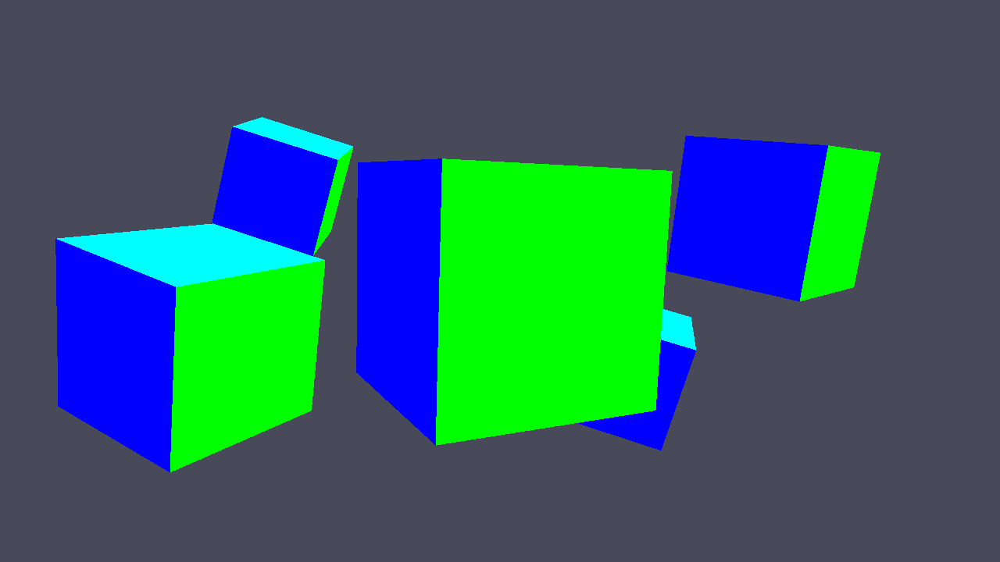
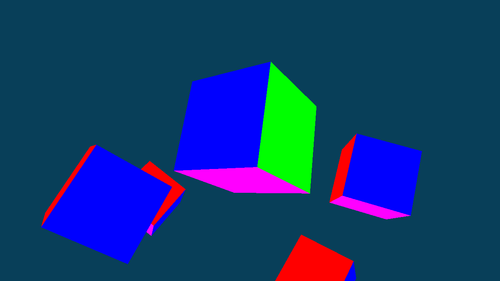
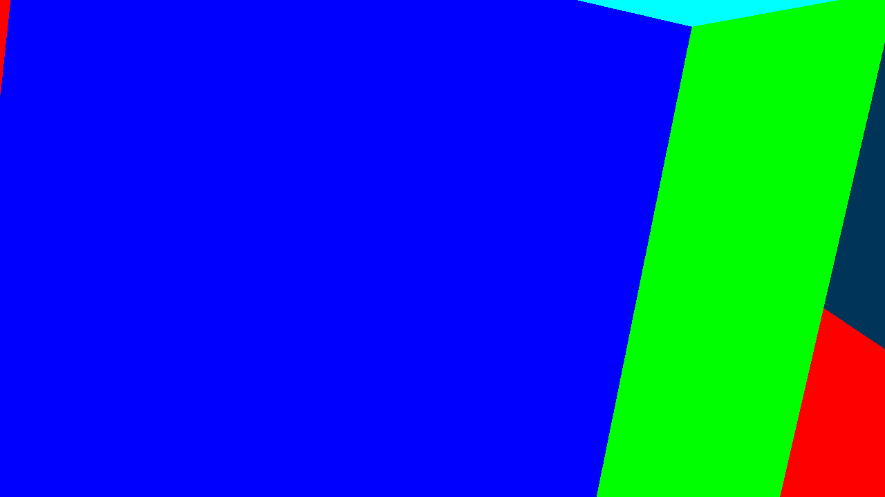
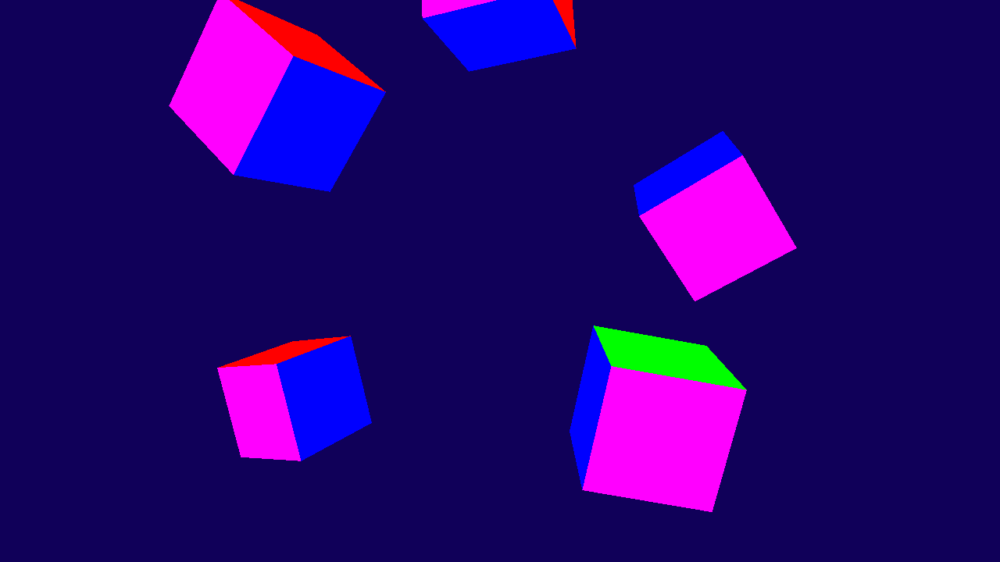
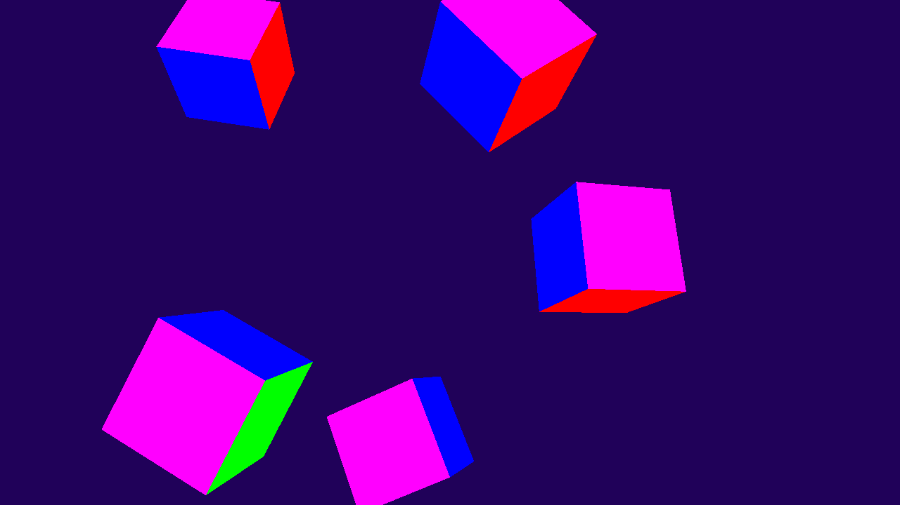
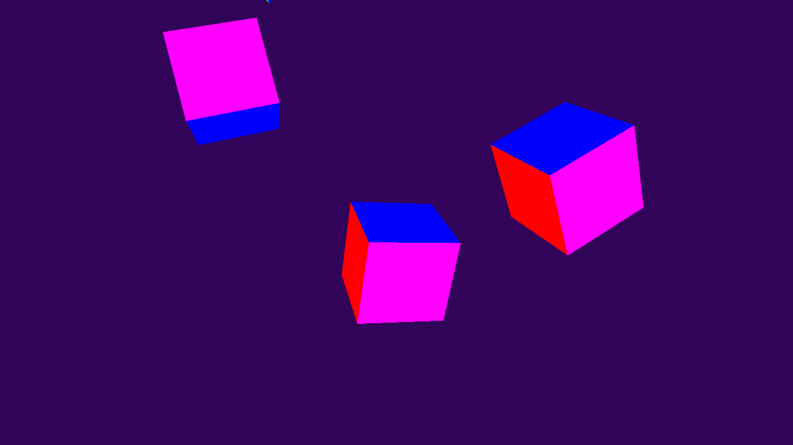
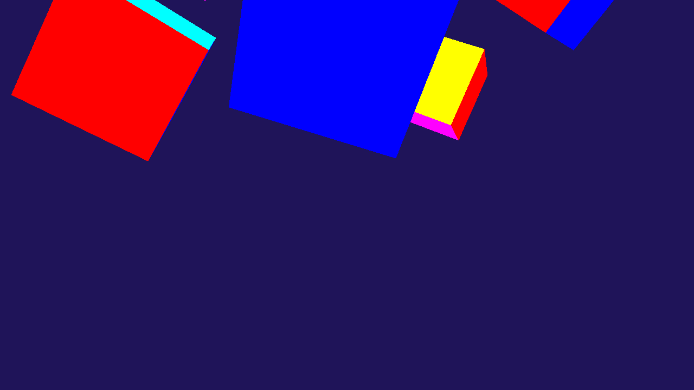
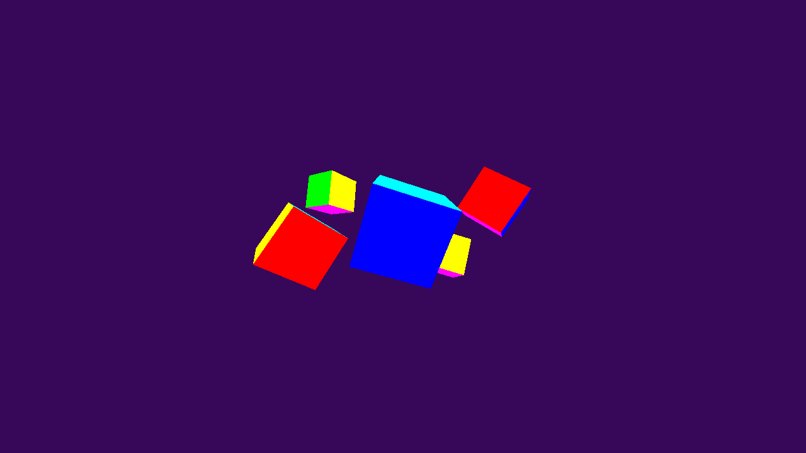

# 10-апта: тінтуірмен еркін камера (yaw, pitch), дөңгелекпен fov

**Файл:** [`main.cpp`](main.cpp) · **Бағдарлама:** `cg_week10` · **Тег:** `week10`

9-аптадағы камера енді **тінтуірмен бұрылады**: `camFront` тұрақты болудан қалды — ол
`yaw` (солға-оңға) мен `pitch` (жоғары-төмен) бұрыштарынан есептеледі. Дөңгелек `fov`-ты
өзгертеді (зум). WASD камера қарап тұрған жаққа жүреді.

```cpp
glm::vec3 dir;
dir.x = cos(glm::radians(yaw)) * cos(glm::radians(pitch));
dir.y = sin(glm::radians(pitch));
dir.z = sin(glm::radians(yaw)) * cos(glm::radians(pitch));
camFront = glm::normalize(dir);
```



## Базалық бөлім

| Қадам | Не жасалды | Кодта қай жерде |
|-------|------------|-----------------|
| 1 | `yaw = -90`, `pitch`, `lastX`, `lastY`, `firstMouse`, `fov`; `<cmath>` | файлдың басы |
| 2 | `GLFW_CURSOR_DISABLED`, `glfwSetCursorPosCallback`, `glfwSetScrollCallback` | `main()`, GLAD-тан кейін |
| 3 | `mouse_callback`: `firstMouse`, `yoffset = lastY - ypos`, sensitivity, ±89°, `camFront` | `mouse_callback` |
| 4 | `scroll_callback`: `fov -= yoffset`, шегі 1 … 90 | `scroll_callback` |
| 5 | `perspective(glm::radians(fov), ...)` — тұрақты 45 орнына | цикл ішінде |

Тексеру — бес нәрсе де жұмыс істейді: терезе ашылғанда камера кубқа қарап тұр (секірмейді);
тінтуірмен бұрылады; тінтуір жоғары — камера жоғары; тура жоғары қарағанда сахна аударылмайды
(±89°); дөңгелекті алға айналдырғанда куб үлкейеді.

| Бастапқы көрініс | Жоғары қарап тұрған куб | Дөңгелекпен жақындатылған (fov = 15) |
|------------------|------------------------|-------------------------------------|
|  |  |  |

`02-looking-up`: камера кубтардың астында (`y = -2`), `pitch = 33°`.

## 1-тапсырма: шектеуді алып көру

`L` пернесі pitch шектеуін (±89°) өшіреді/қосады — код өзгертпей тәжірибе жасау үшін.
Камера кубтардың астында (`(0, -6, -1.5)`), тінтуір баяу жоғары апарылды:

| pitch = 80° | pitch = 90° | pitch = 100° |
|-------------|-------------|--------------|
|  |  |  |

**Не болды.** `pitch = 90`-да сурет кездейсоқ бұрышқа бұрылып кетті, `pitch = 100`-де сахна
**төңкеріліп** қалды (80°-пен салыстыр). Біздің компьютерде экран ақ/бір түсті болған жоқ,
`NaN` шыққан жоқ — `P` басқанда `camFront = (0.00, 1.00, 0.00)`, `length = 1`.

**Неге NaN шықпады.** Математикада `cos(90°) = 0`, бірақ компьютерде `glm::radians(90.0f)`
дәл π/2 емес (float дәлдігі), сондықтан `cos` нөл емес, `-0.0000000437` береді.
`camFront` тура жоғарыға өте жақын, бірақ дәл жоғары емес. lookAt-тағы
`cross(worldUp, Direction)` нөл емес, өте кішкентай вектор береді, ал оның бағыты
кездейсоқ — сондықтан сурет бұрылып кетеді. Ал pitch 90-нан асқанда «оң жақ» векторы кері
бағытқа ауысады — сахна төңкеріледі. Дәл нөл түссе (мысалы, double-да немесе басқа
драйверде), `normalize(0, 0, 0)` → `0/0` → `NaN` → экран бір түсті болады.

Тәжірибеден кейін шектеу қайтарылды: `g_pitchLimit = true` — әдепкі күй.

## 2-тапсырма: sensitivity-ді баптау

Үш мән: `0.03`, `0.1`, `0.5`. Толық айналым (360°) үшін тінтуірді неше пиксель жылжыту
керек: `360 / sensitivity` → 12 000 / 3 600 / 720 пиксель.
(Бұл — есеп. Қолмен сынау өз тінтуіріңде жасалады: `const float sensitivity`-ді өзгертіп, қайта құрастыр.)

**Таңдалған мән: `0.1`** — бір-екі рет қозғағанда толық айналады, бірақ кішкентай қозғалыстан
камера секірмейді (`0.03` тым баяу, `0.5` тым сезімтал).

## 3-тапсырма: Invert Y

`I` пернесі `yoffset`-тің таңбасын ауыстырады. Перне басулы тұрғанда әр кадрда ауысып кетпес
үшін алдыңғы күй сақталады (`iPressedLast`).

Тексеру: invert Y қосулы кезде тінтуір 200 пиксель **жоғары** апарылды → `pitch = -20`
(камера төмен қарады). Екінші рет `I` басқанда бағыт қайтады.



## 4-тапсырма: камера күйін басып шығару

`P` пернесі:

```
camPos   = (0.00, 0.00, 3.00)
camFront = (0.00, 0.00, -1.00)
yaw = -90.0   pitch = 0.0   fov = 45.0
length = 1
```

Тінтуір қозғалғаннан кейін де `length = 1` (бірнеше рет тексерілді).

## 5-тапсырма: зум шегін өзгерту

`fov`-тың жоғарғы шегі 45-тен **90**-ға көтерілді. Дөңгелекті артқа айналдырып, 90°-қа жеткіздік:
кубтар кішірейіп, экранның шеттеріндегі кубтар созылып көрінеді.



## Қосымша (міндетті емес)

| Не | Күйі |
|----|------|
| Қ1. Жүгіру | 9-аптадан бері бар, бірақ `Left Ctrl`-мен: `Shift` төмен түсуге берілген |
| Қ2. Бұрыштарды терезе тақырыбында көрсету | жасалды — `yaw=… pitch=… fov=…` |
| Қ3. `R` — бастапқы күй | жасалды: `camPos`, `camFront`, `yaw`, `pitch`, `fov` |
| Қ4. Yaw-ды шектеу | жасалды: тінтуір екі рет 400°-қа бұрылды → `yaw`: `-90 → 310 → 350` |

## Басқару

| Перне | Әрекет |
|-------|--------|
| Тінтуір | қарау бағыты (yaw, pitch) |
| Дөңгелек | зум (fov 1 … 90) |
| W / A / S / D | жүру |
| Space / Left Shift | жоғары / төмен |
| Left Ctrl | жүгіру (×2) |
| I | invert Y |
| L | pitch шектеуін өшіру/қосу (1-тапсырма) |
| P | камера күйін консольге шығару |
| R | бастапқы күй |
| Tab | wireframe |
| Esc | шығу |

## Қорғауға жауаптар

- **Неге `yaw = -90`?** `x = cos(yaw)`: yaw = 0 болса, камера +X-ке қарайды да, куб көрінбейді.
  Камера -Z-ке (кубқа) қарау үшін +X-тен 90° бұру керек.
- **Неге `firstMouse`?** Бірінші оқиғада `lastX = 640`, ал курсор басқа жерде болуы мүмкін —
  айырмасы жүздеген пиксель, камера бір сәтте лақтырылады. Бірінші оқиғада тек есте сақтаймыз.
- **Неге `lastY - ypos`?** Экранның `y`-і төмен қарай өседі, ал `pitch` жоғары қарай.
- **Неге `glm::radians`?** `cos` пен `sin` радиан күтеді, ал `yaw` мен `pitch` градуспен сақталған.
- **Нақты қай есептеу NaN береді?** `cos(90°) = 0` → `camFront = (0, 1, 0)` → lookAt-та
  `cross(worldUp, Direction) = cross((0,1,0), (0,1,0)) = (0, 0, 0)` → `normalize` нөлге бөледі →
  NaN. Біздің float есептеуінде `cos` дәл нөл болмады (1-тапсырманы қара), бірақ нәтиже сонда да
  бұзылды.
- **`sensitivity` неге `const`?** Ол функция ішінде өзгермейтін баптау. Жаһандық айнымалы етіп,
  пернемен өзгертуге болады — ойындардағы «тінтуір сезімталдығы» баптауы осылай жасалады.
- **Алдыңғы күйді сақтамасақ не болады? Неге бұл мәселе WASD-та жоқ?** Перне бірнеше кадр
  басулы тұрады — invertY әр кадрда ауысып, кездейсоқ күйде қалады. WASD-та «басулы тұрғанда
  жүре бер» керек, сондықтан әр кадрда қайталану — дұрыс мінез.
- **Ұзындық неге 0.99999 болуы мүмкін?** float дәлдігі шектеулі — `normalize` бөлгенде
  дөңгелектеу қатесі қалады. `normalize`-ды алып тастасаң, ұзындық `cos(pitch)`-қа байланысты
  өзгеріп, 1-ден кіші де, үлкен де болуы мүмкін (мұнда формула ұзындықты 1 береді, бірақ
  тек математикада).
- **Үлкен fov-та сурет неге созылады?** Бұл қате емес — перспективалық проекцияның қасиеті:
  шеттегі нүктелер `tan(fov/2)` бойымен проекцияланады, fov үлкейген сайын шеттер көбірек
  созылады (7-аптадағы проекция матрицасы).
- **Неге `camUp` (0, 1, 0) күйінде қалады?** `camUp` өзгерсе, бұрылғанда сурет қисаяды
  (камера еңкейеді).
