# 11-апта: текстуралар

**Файл:** [`main.cpp`](main.cpp) · **Бағдарлама:** `cg_week11` · **Тег:** `week11`
**Сурет:** [`assets/container.png`](../assets/container.png) (512 × 512, 3 арна)

Кубтардың түстері алынып, орнына **сурет** жапсырылды. Әр вершинада енді позиция + екі UV
саны (stride 5). Сурет `stb_image` арқылы жүктеледі, `loadTexture()` текстура объектісін
жасайды, фрагмент шейдері `texture(ourTexture, vTexCoord)` арқылы түсті суреттен алады.

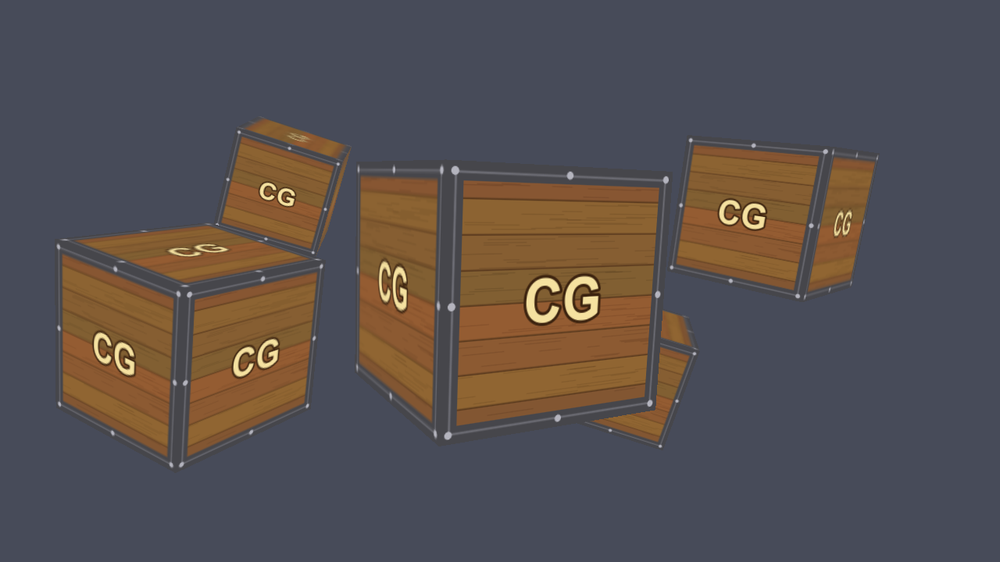

Терминалда: `C:/dev/computer-graphics/assets/container.png 512x512 арна: 3`.

## Базалық бөлім

| Қадам | Не жасалды | Кодта қай жерде |
|-------|------------|-----------------|
| 1 | `#define STB_IMAGE_IMPLEMENTATION` + `#include <stb_image.h>` (`external/stb/`) | файлдың басы |
| 2 | `assets/container.png`, жол `ASSET_DIR` арқылы | `std::string(ASSET_DIR) + "/container.png"` |
| 3 | `vertices[]`: түстің орнына UV, алты жақта UV реті бірдей, CCW сақталды | `vertices[]` |
| 4 | Атрибуттар: UV — `location 1`, 2 float, stride `5 * sizeof(float)` | `glVertexAttribPointer` |
| 5 | Шейдерлер: `aTexCoord` → `vTexCoord`, `sampler2D ourTexture`, `texture()` | `vertexSrc`, `fragmentSrc` |
| 6 | `loadTexture()`: `glGenTextures`, `glTexParameteri` ×4, `glTexImage2D`, `glGenerateMipmap`, `stbi_image_free` | `loadTexture` |
| 7 | Render: `glUniform1i(..., 0)`, `glActiveTexture(GL_TEXTURE0)`, `glBindTexture` | цикл алдында және ішінде |

Тексеру — төрт нәрсе: терминалда жазу шықты; алты жақта да сурет бар; сурет төңкерілмеген
(«CG» жазуы дұрыс оқылады); алыстаған кубтар жыпылықтамайды (mipmap).

`container.png` — осы жобаға Python (Pillow) арқылы салынған сурет: ағаш жәшік және «CG» жазуы,
сурет төңкерілген-төңкерілмегенін бірден көру үшін.

## 1-тапсырма: орау режимдері

`2` пернесі UV мәндері **2.0-ге** көбейтілген кубқа ауыстырады (`vertices2[]` — `vertices[]`-тің
көшірмесі, UV-лері 2-ге көбейтілген, бөлек VAO). `1` пернесі режимді кезекпен ауыстырады.

| `GL_REPEAT` | `GL_MIRRORED_REPEAT` |
|-------------|----------------------|
| 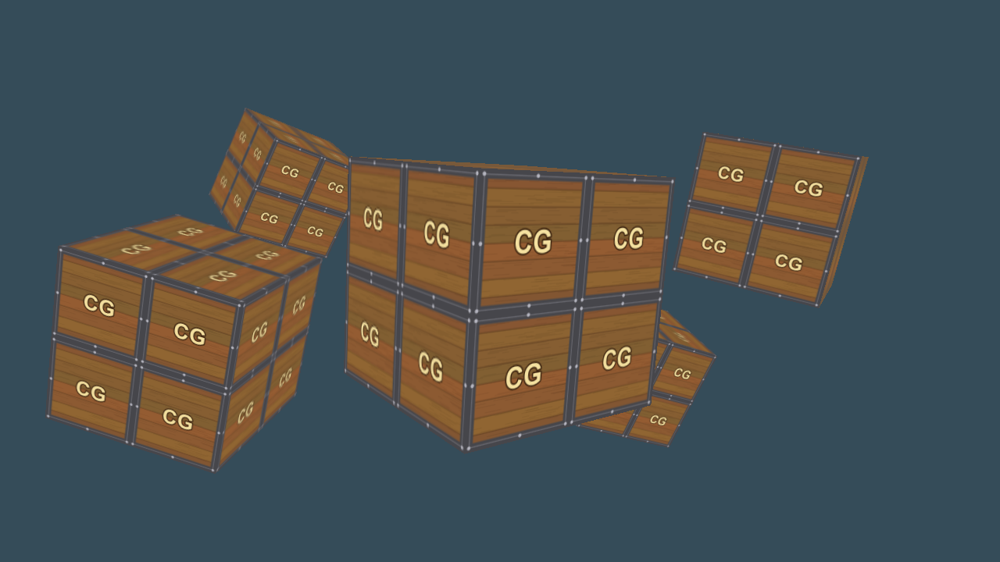 | 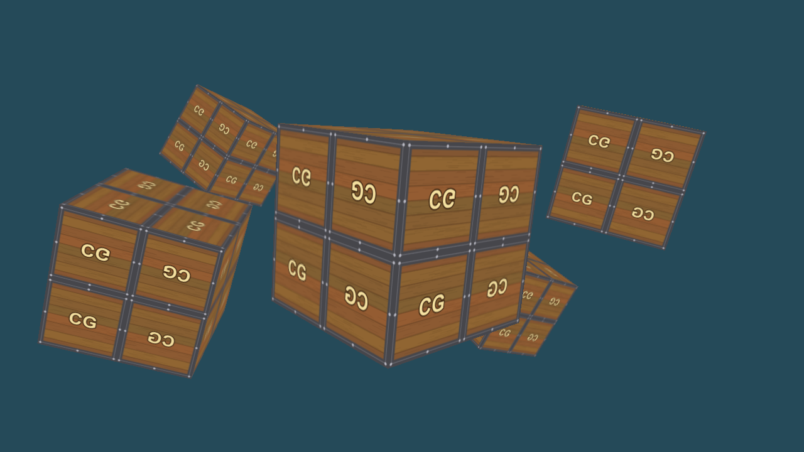 |
| **`GL_CLAMP_TO_EDGE`** | **`GL_CLAMP_TO_BORDER`** (қызыл шекара) |
| 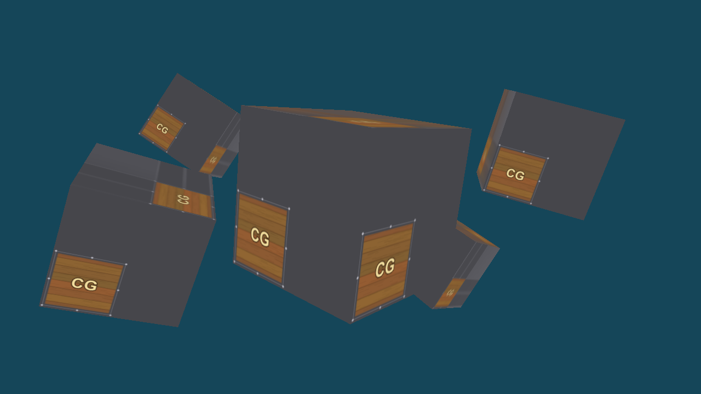 | 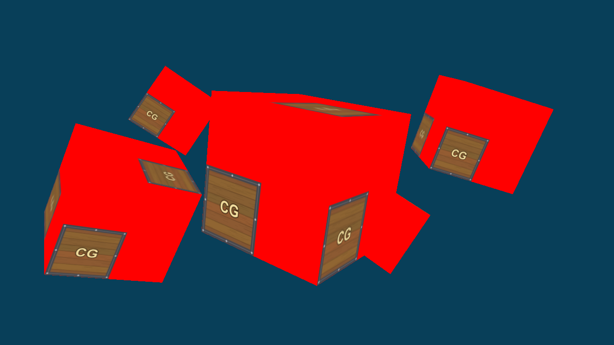 |

- **`GL_REPEAT`** — сурет әр жақта 2×2 қайталанады. Кірпіш, еден, шөп сияқты қайталанатын беттерге.
- **`GL_MIRRORED_REPEAT`** — көрші даналар айнадай шағылысады («CG» кері жазылған). Тігіс
  көрінбеуі керек табиғи текстураларға (тас, құм).
- **`GL_CLAMP_TO_EDGE`** — шеттегі пиксель созылады. Қайталанбауы керек суреттерге: аспан,
  UI, жазулар.
- **`GL_CLAMP_TO_BORDER`** — сурет сыртында берілген түс (мұнда қызыл). Декаль, белгі —
  суреттен тыс жерде «ештеңе» болуы керек кезде.

## 2-тапсырма: NEAREST пен LINEAR

`[` пернесімен `uvScale = 0.1` (суреттің кішкентай бөлігі бүкіл жаққа созылады), дөңгелекпен
`fov = 8°`. `N` пернесі `GL_TEXTURE_MAG_FILTER`-ді ауыстырады.

| `GL_NEAREST` — шаршылар | `GL_LINEAR` — жұмсақ ауысу |
|-------------------------|---------------------------|
| 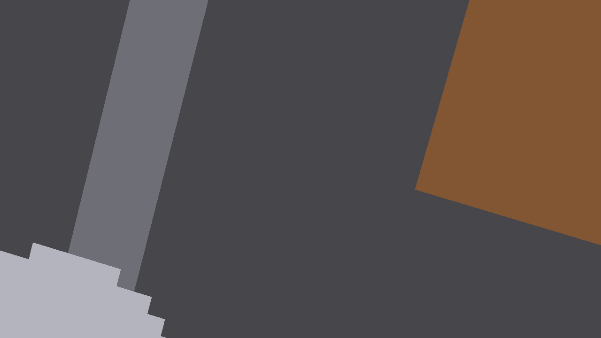 |  |

## 3-тапсырма: mipmap әсері

`cubePositions[]`-ке `z = -40` маңында тағы алты куб қосылды. `M` пернесі
`GL_TEXTURE_MIN_FILTER`-ді ауыстырады: `GL_LINEAR_MIPMAP_LINEAR` ↔ `GL_LINEAR`.

| Mipmap бар | Mipmap жоқ |
|-----------|------------|
|  | 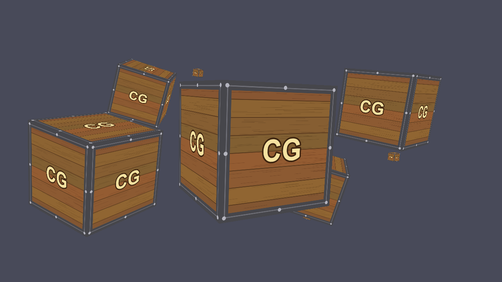 |

Алыстағы бір куб, 4 есе үлкейтілген (сол — mipmap бар, оң — жоқ):

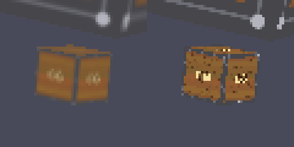

Айырмашылық: mipmap-сыз алыстағы кубтың беті «шулы» — кездейсоқ ашық/қара нүктелер,
камера қозғалғанда олар жыпылықтайды. Mipmap-пен беті тегіс, бір қалыпты.

## 4-тапсырма: қара кубты әдейі шығару

`B` пернесі `glTexParameteri(GL_TEXTURE_2D, GL_TEXTURE_MAG_FILTER, GL_LINEAR_MIPMAP_LINEAR)`
шақырады, содан кейін `glGetError()`-ды консольге шығарады.

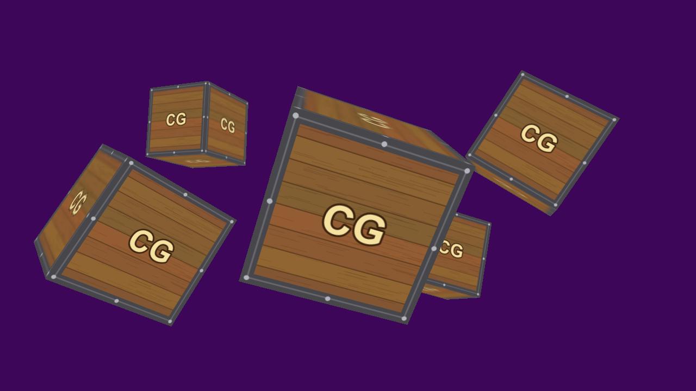

**Біздің компьютерде куб қара болған жоқ.** Консоль: `glGetError() = 1280` — бұл
`GL_INVALID_ENUM`. OpenGL стандарты бойынша MAG_FILTER тек `GL_NEAREST` немесе `GL_LINEAR`
бола алады; басқа мән келсе, драйвер командаты **елемейді** (параметр бұрынғы `GL_LINEAR`
болып қалады) және қате жалауын қояды. Кейбір драйверлер мұндай текстураны «толық емес» деп
санап, қара түс береді — тапсырмадағы нәтиже сондықтан. Қате түзетілді: екінші рет `B` →
`GL_LINEAR`, `glGetError() = 0`.

## 5-тапсырма: UV масштабын пернемен басқару

Фрагмент шейдерінде `uniform float uvScale`, `texture(ourTexture, vTexCoord * uvScale)`.
`[` / `]` — 0.1 … 8.0 (`uvScale += 2.0f * dt` — үздіксіз әрекет, сондықтан `dt`).
`uvScale = 4.0` — сурет әр жақта 4×4 қайталанады:

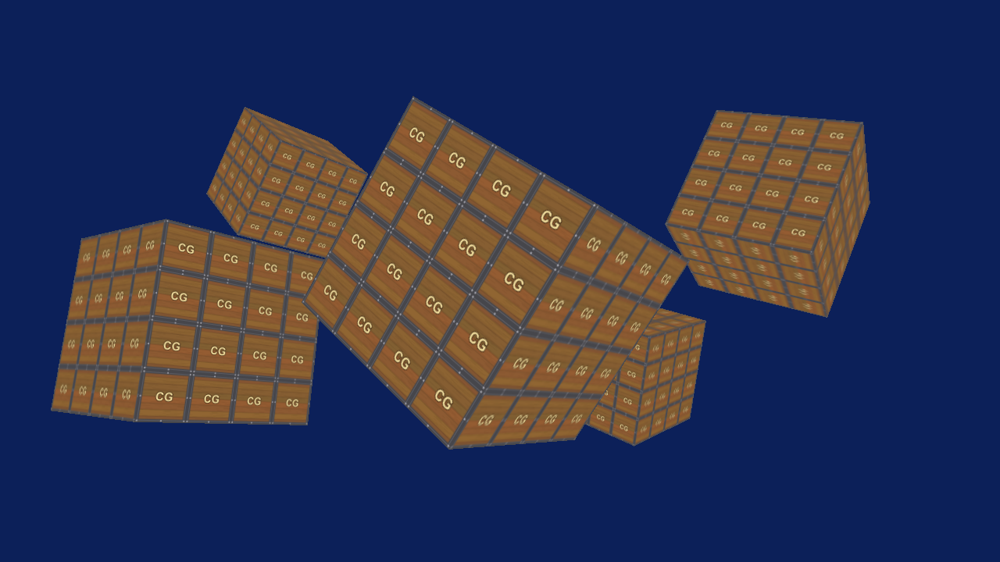

## Қосымша (міндетті емес)

| Не | Перне | Күйі |
|----|-------|------|
| Қ1. Өз суретің | — | `container.png` өзіміз салған сурет (3 арна). 4 арналы PNG 12-аптада (`logo.png`) |
| Қ2. Текстураны түспен көмкеру (`tint` уақыт бойынша) | `T` | жасалды 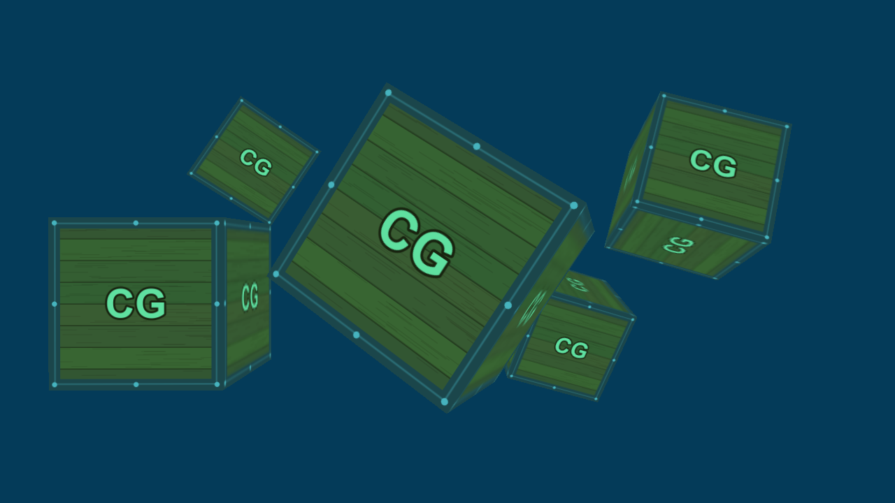 |
| Қ3. Ағып жатқан су (`vTexCoord + vec2(0, time * 0.1)`) | `F` | жасалды 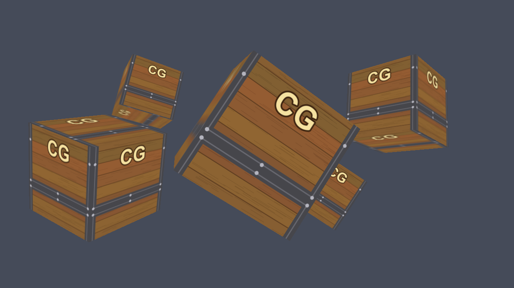 |
| Қ4. Анизотропты фильтрация | `K` | жасалды: консоль `anisotropy = 16` (бұл видеокартада ең үлкені) |

## Басқару

| Перне | Әрекет |
|-------|--------|
| Тінтуір / дөңгелек / WASD / Space / Shift / Ctrl | камера (10-апта) |
| 1 | орау режимі: REPEAT → MIRRORED → CLAMP_EDGE → CLAMP_BORDER |
| 2 | UV × 2 бар куб |
| N | MAG_FILTER: LINEAR / NEAREST |
| M | MIN_FILTER: mipmap / mipmap-сыз |
| B | MAG_FILTER-ге mipmap тұрақтысы (4-тапсырма) |
| [ / ] | UV масштабы |
| T / F / K | tint / ағыс / анизотропия |
| I | invert Y |
| P | күйді консольге шығару |
| R | бастапқы күй |
| Tab | wireframe |
| Esc | шығу |

## Қорғауға жауаптар

- **`GL_REPEAT` пен `GL_MIRRORED_REPEAT`-тың айырмашылығы қай жерде көрінеді?** Даналардың
  түйіскен жерінде. REPEAT-та бір дананың оң шеті келесінің сол шетімен түйіседі — шеттері
  әртүрлі болса, **тігіс** көрінеді. MIRRORED-та шеттер айнадай — тігіс жоқ, бірақ жазу кері.
- **Пиксель-арт ойынында қайсысы, фотореалистік ойында қайсысы?** Пиксель-артта `GL_NEAREST` —
  пиксельдер анық шаршы болып қалуы керек. Фотореалистікте `GL_LINEAR` — жұмсақ, бұлыңғыр емес ауысу.
- **Бір фрагментке неше texel келеді (512×512 текстура, куб экранда 20×20)?**
  `512 / 20 ≈ 25.6` — әр бағытта, барлығы `25.6² ≈ 655` texel бір пиксельге. Mipmap-сыз
  GPU солардың біреуін ғана алады — сондықтан шу. Mipmap-пен `log2(25.6) ≈ 4.7` → 5-деңгей
  (16×16) таңдалады — фрагментке **≈ 1 texel**.
- **Қатені қалай табар едің? `glGetError()` көмектесе ме?** Иә: бұл жерде ол 1280
  (`GL_INVALID_ENUM`) берді. `glGetError()`-ды күдікті шақырудан кейін тексеру керек
  (немесе `glDebugMessageCallback`).
- **Қара кубтың басқа себептері (кемінде үшеуі)?** 1) `glGenerateMipmap` шақырылмаған, бірақ
  MIN_FILTER mipmap-ты күтеді; 2) сурет жүктелмеді (жол қате, `ASSET_DIR` жоқ); 3) render-де
  `glBindTexture` жоқ немесе басқа текстура байланған; 4) `fmt` қате (4 арналы PNG-ге `GL_RGB`).
- **UV-ді шейдерде көбейту мен `vertices[]` ішінде көбейтудің айырмашылығы?** `vertices[]`-те —
  деректер бір рет GPU-ға жіберіледі, әр кадрда есептеу жоқ (жылдамырақ), бірақ өзгерту үшін
  буферді қайта жүктеу керек. Шейдерде — әр фрагментте бір көбейту, бірақ uniform арқылы кез
  келген сәтте өзгертуге болады (икемдірек).
- **Неге `stbi_set_flip_vertically_on_load(true)`?** Суретте (0, 0) — жоғарғы сол бұрыш,
  ал OpenGL UV-де (0, 0) — төменгі сол. Аудармаса, сурет төңкеріледі.
- **Неге `glGenerateMipmap` `glTexImage2D`-дан кейін?** Mipmap — жүктелген суреттің кішірейтілген
  көшірмелері; сурет жоқта кішірейтетін ештеңе жоқ.
