# 12-апта: бірнеше текстура, текстуралық блоктар, араластыру

**Файл:** [`main.cpp`](main.cpp) · **Бағдарлама:** `cg_week12` · **Тег:** `week12`
**Суреттер:** [`assets/`](../assets) — `container.png` (3 арна), `pattern.png` (3 арна), `logo.png` (4 арна)

Бір кубта **екі текстура**: жәшік пен өрнек. Әр текстура өз блогына байланады
(`GL_TEXTURE0`, `GL_TEXTURE1`), шейдердегі `texture1`, `texture2` sampler-лері блок нөмірін
алады (0, 1). Фрагмент шейдері екеуін `mix(a, b, blend)` арқылы араластырады, `blend` ↑/↓
пернелерімен 0 … 1 аралығында біртіндеп өзгереді.

Терминалда:

```
GL_MAX_TEXTURE_IMAGE_UNITS: 32
C:/dev/computer-graphics/assets/container.png 512x512 арна: 3
C:/dev/computer-graphics/assets/pattern.png 512x512 арна: 3
C:/dev/computer-graphics/assets/logo.png 512x512 арна: 4
```

| `blend = 0` — тек жәшік | `blend = 0.5` — жартылай | `blend = 1` — тек өрнек |
|---|---|---|
| 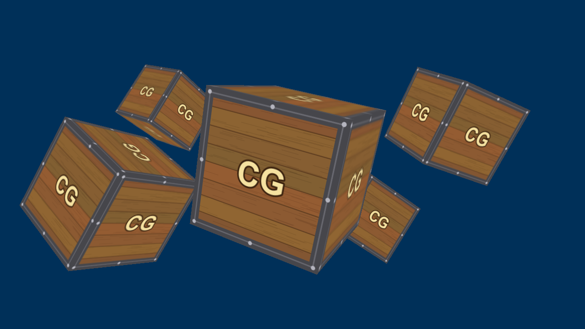 | 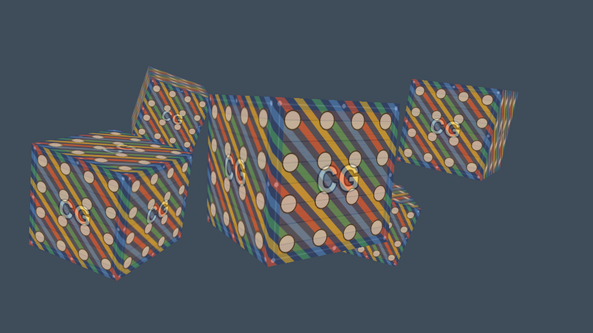 | 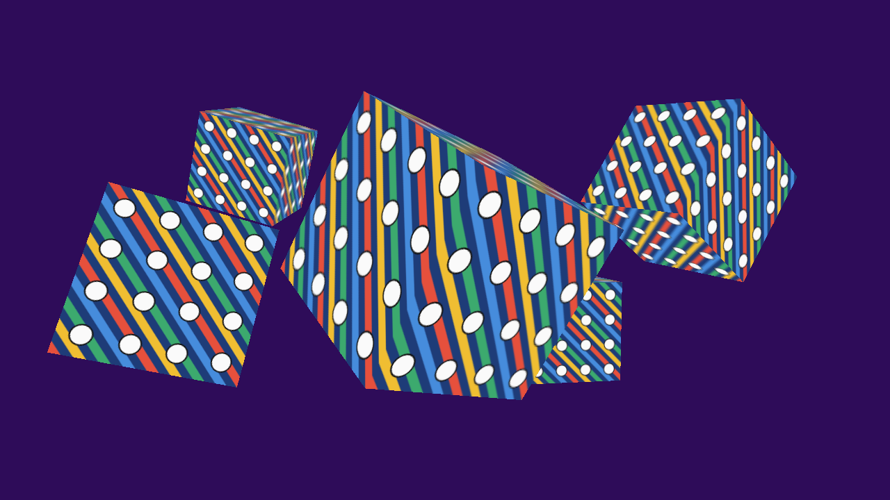 |

## Базалық бөлім

| Қадам | Не жасалды | Кодта қай жерде |
|-------|------------|-----------------|
| 1 | Екі текстура `loadTexture()`-пен (11-аптадағы функция өзгеріссіз) | `tex1`, `tex2` |
| 2 | Шейдерде екі sampler + `uniform float blend`, `mix(...)` | `fragmentSrc` |
| 3 | `glUseProgram` → `glUniform1i(texture1, 0)`, `glUniform1i(texture2, 1)` — бір рет, циклге дейін | `main()` |
| 4 | Render: `glActiveTexture(GL_TEXTURE0)` → `glBindTexture(tex1)`, `glActiveTexture(GL_TEXTURE1)` → `glBindTexture(tex2)` | цикл ішінде |
| 5 | ↑/↓ — `blend += 0.5f * dt`, 0 … 1 шектеледі; `glUniform1f(blendLoc, blend)` | `processInput`, цикл |

## 1-тапсырма: блоктарды әдейі шатастыру

`1` пернесі екі `glActiveTexture` жолын «өшіреді» (бағдарлама басынан оларсыз іске қосылғандай:
1-блок бос, белсенді — 0-блок).

| `blend = 0` | `blend = 0.5` | `blend = 1` |
|---|---|---|
| 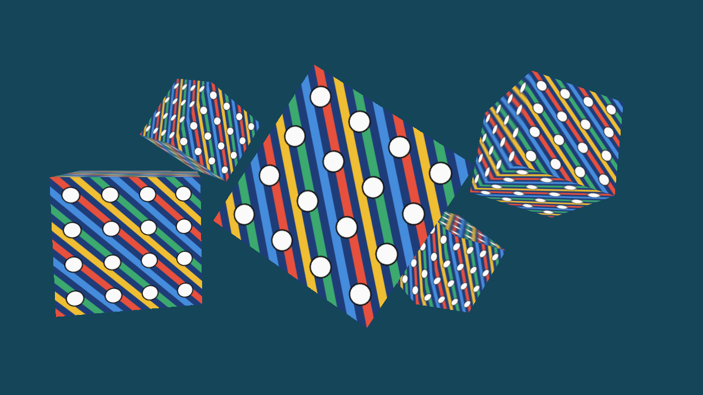 | 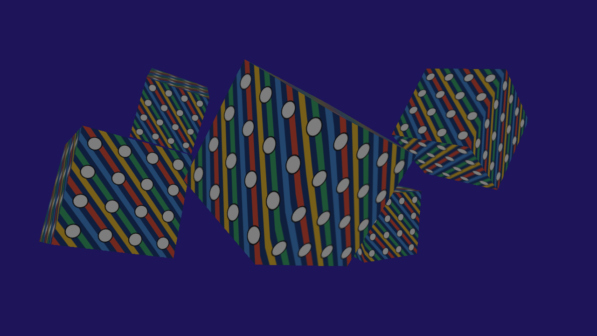 | 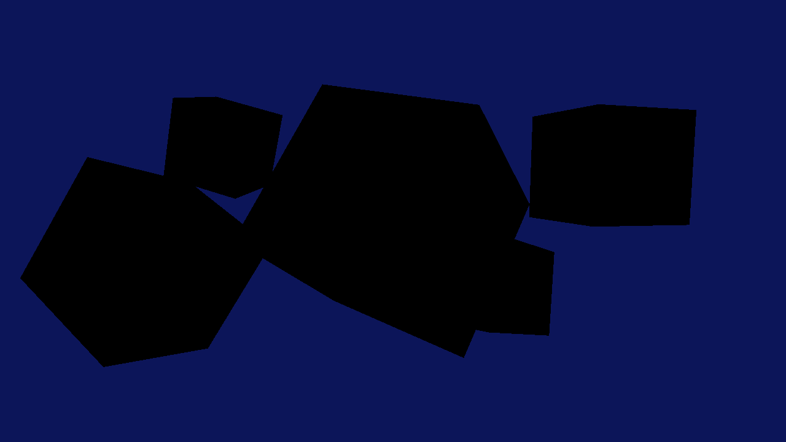 |

- **`blend = 0`** — жәшік емес, **өрнек** көрінеді.
- **`blend = 1`** — кубтар **қара**.

Себебі: екі `glBindTexture` те 0-блокқа түседі, `tex2` `tex1`-ді ығыстырып шығарады.
0-блокта — `pattern.png`, 1-блокта — ештеңе жоқ, сондықтан `texture2` қара оқиды.
Тәжірибеден кейін жолдар қайтарылды (`1` тағы басылса).

## 2-тапсырма: қатерлі қате

`2` пернесі `glUniform1i(glGetUniformLocation(shader, "texture2"), tex2)` жазады — блок
нөмірінің орнына текстура ID-сі. Терминалда: `tex1 = 1   tex2 = 2`.

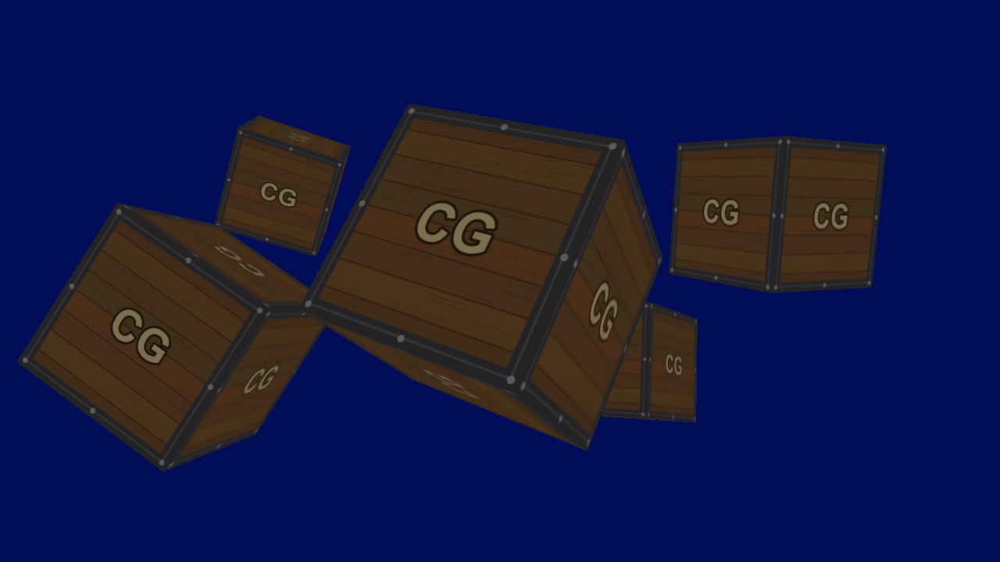

`tex2`-нің ID-і **2** болды → `texture2` 2-блоктан оқиды, ал онда ештеңе жоқ → екінші текстура
қара, жәшік қараңғыланды. Егер ID кездейсоқ 1-ге тең болса, код **жұмыс істеп тұрғандай**
көрінер еді — қате жазылған сәтте емес, жаңа текстура қосылып, ID-лер жылжыған сәтте «пайда
болады». Сондықтан блок нөмірі әрқашан әріппен: `0`, `1`.

## 3-тапсырма: төрт араластыру тәсілі

`3` пернесі кезекпен ауыстырады: `mix(a, b, blend)` → `a * b` → `a + b` → `clamp(a + b, 0, 1)`.

| `mix` (blend = 0.5) | `a * b` — көбейту | `a + b` — қосу | `clamp(a + b)` |
|---|---|---|---|
|  | 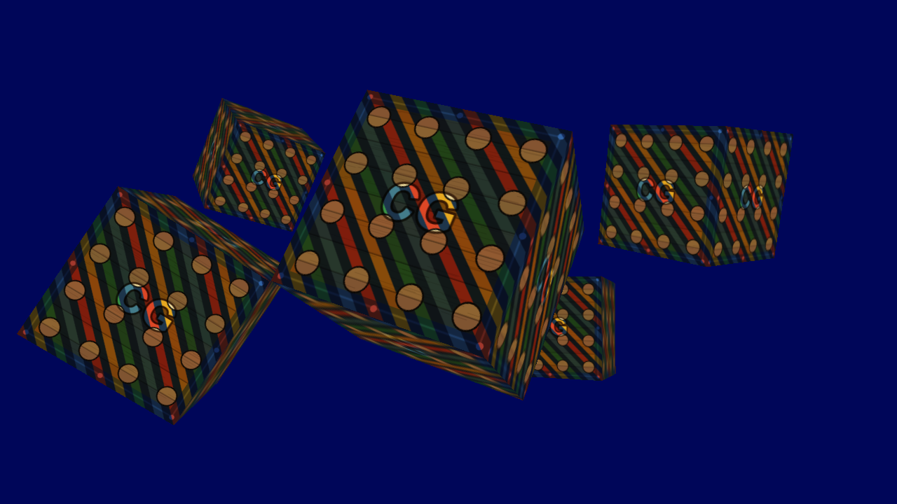 | 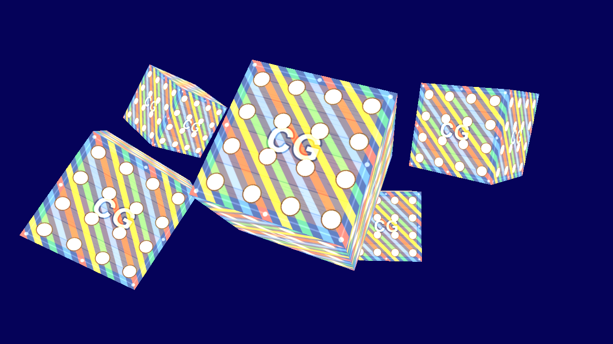 | 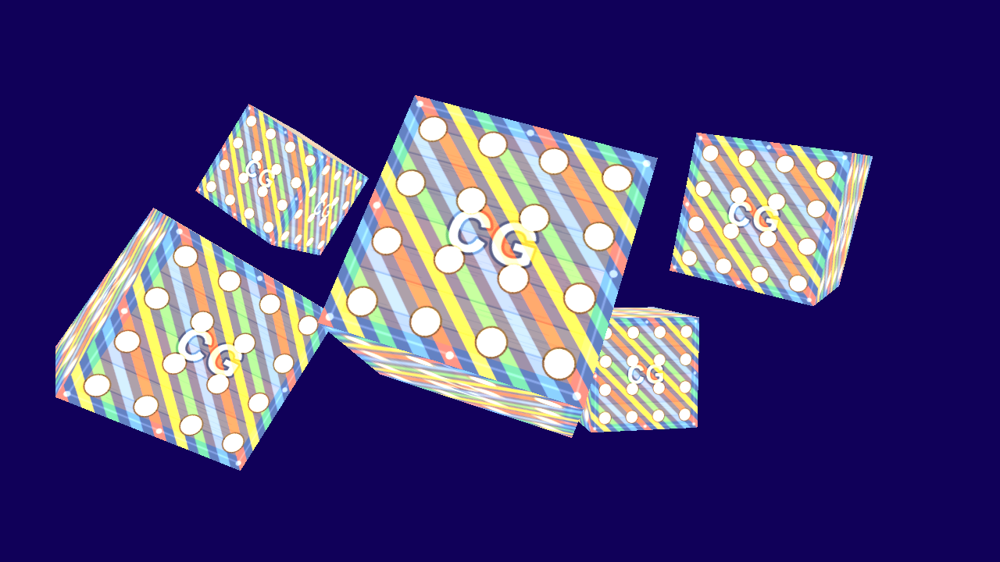 |

Үшінші нұсқада түстер 1-ден асып кетеді — сурет аппақ болып қалады. Төртінші нұсқа шекті
нақты қояды (`clamp`), бірақ ақшыл түстер бәрібір жоғалады: экранға шыққанда 1-ден үлкен мән
бәрібір 1-ге кесіледі, сондықтан `a + b` пен `clamp(a + b)` көзге бірдей.

## 4-тапсырма: логотипті альфамен жапсыру

`4` пернесі: екінші текстура `pattern.png`-ден `logo.png`-ге ауысады (4 арна, фоны мөлдір),
`FragColor = mix(base, decal, decal.a)`.

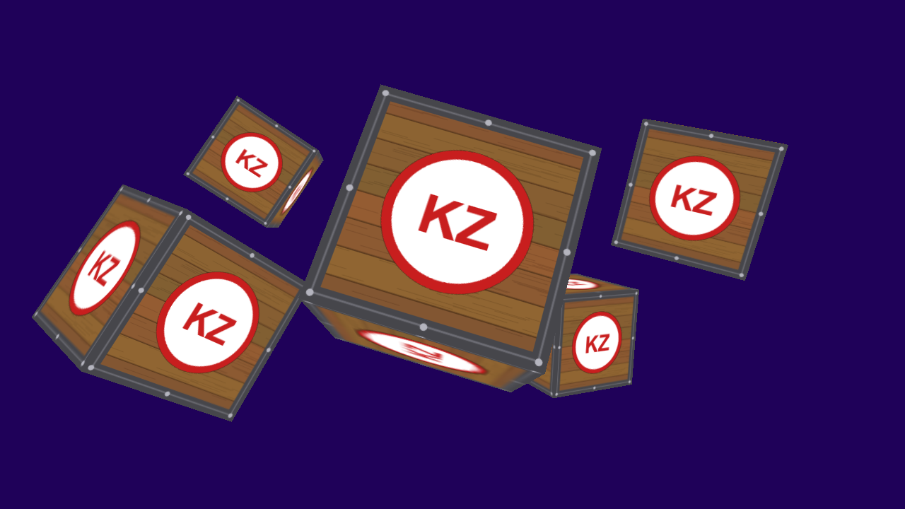

Терминалда `logo.png 512x512 арна: 4` — `fmt` логикасы `GL_RGBA`-ны дұрыс таңдады.

## 5-тапсырма: кеңістіктік ауысу

`5` — `mix(a, b, vTexCoord.y)`, `6` — `mix(a, b, smoothstep(0.3, 0.7, vTexCoord.y))`.
Екінші текстура — `pattern.png`. Кубтың әр жағы төменнен жоғары қарай жәшіктен өрнекке ауысады.

| `vTexCoord.y` — біркелкі ауысу | `smoothstep` — тік ауысу |
|---|---|
| 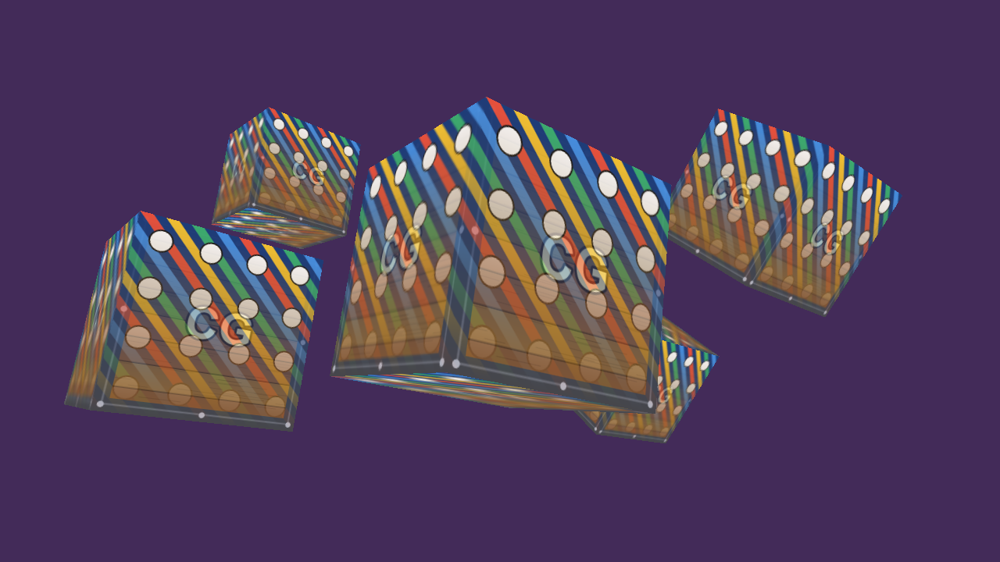 | 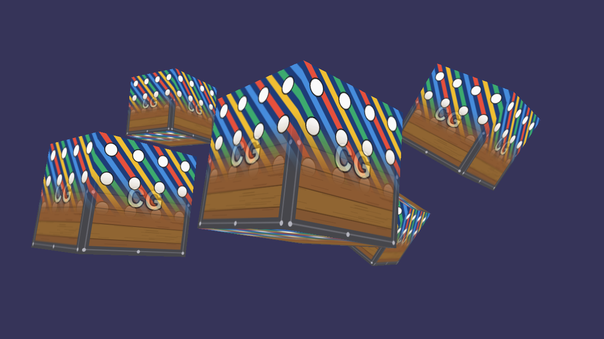 |

## Қосымша (міндетті емес)

| Не | Перне | Нәтиже |
|----|-------|--------|
| Қ1. Үш текстура: `surface = mix(a, b, blend)`, үстінен логотип (`GL_TEXTURE2`) | `7` | 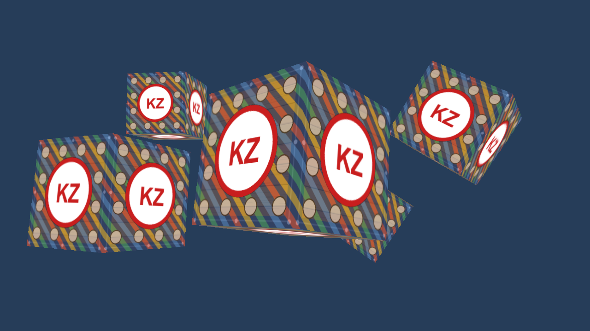 |
| Қ2. Автоматты ауысу: `blend = 0.5 + 0.5 * sin(time)` | `B` | жасалды |
| Қ3. Әр жаққа бөлек коэффициент: алты `glDrawArrays`, `blend = f / 5` | `F` | 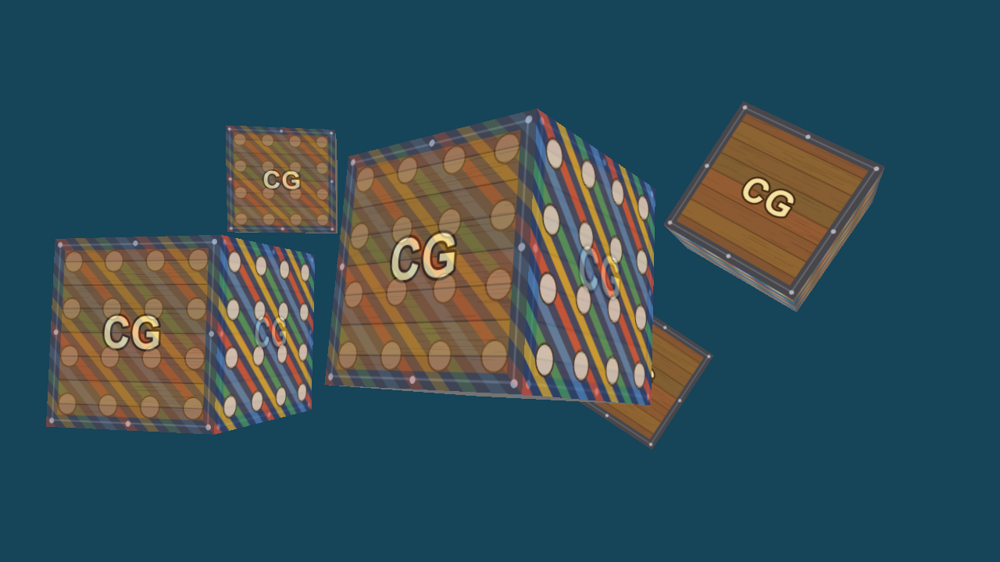 |
| Қ4. Логотипті айналдыру (UV центрден бұрылады), `GL_CLAMP_TO_BORDER` мөлдір шекарамен | `4`, сосын `L` | 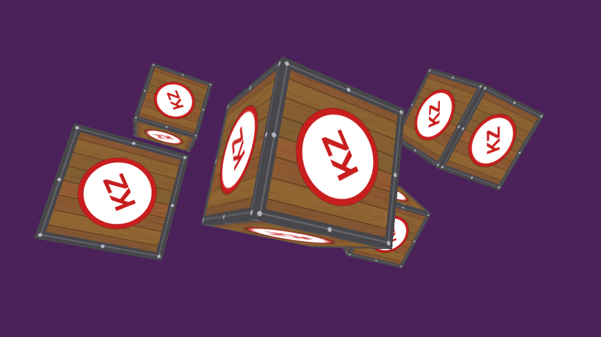 |

## Басқару

| Перне | Әрекет |
|-------|--------|
| ↑ / ↓ | blend |
| 1 | `glActiveTexture`-сыз (1-тапсырма) |
| 2 | `glUniform1i`-ге ID (2-тапсырма) |
| 3 | `mix` → `a * b` → `a + b` → `clamp` |
| 4 / 5 / 6 / 7 | логотип / `vTexCoord.y` / `smoothstep` / үш текстура |
| 0 | қайта `mix(a, b, blend)` |
| B / F / L | автоматты blend / әр жақ бөлек / логотипті айналдыру |
| Тінтуір / дөңгелек / WASD / Space / Shift / Ctrl | камера |
| I / R / Tab / Esc | invert Y / бастапқы күй / wireframe / шығу |

## Қорғауға жауаптар

- **1-тапсырма: `blend = 0` мен `blend = 1` кезінде не көрінді, екі блокта не тұрды?**
  0-блокта — `tex2` (өрнек), себебі ол `tex1`-ді ығыстырды; 1-блокта — ештеңе (қара).
  `blend = 0` → тек `texture1` → өрнек. `blend = 1` → тек `texture2` → қара.
- **2-тапсырма: `tex2`-нің ID-і нешеге тең болды? 1 болса, код жұмыс істей ме? Неге қауіпті?**
  2. ID 1 болса, кездейсоқ дұрыс блокқа түсіп, жұмыс істейтін еді — қате жасырын қалады да,
  үшінші текстура қосылып, ID-лер жылжығанда кенет бұзылады.
- **3-тапсырма: көбейту неге тек қараңғылатады?** 0 … 1 аралығындағы екі санның көбейтіндісі
  екеуінің кішісінен де кіші (`0.8 · 0.5 = 0.4`). **Кір мен дақ** — көбейту (бетті қараңғылатады),
  **жалын, жарқыл** — қосу (жарықтандырады).
- **4-тапсырма: үш альфа жағдайы?** `a = 0` → тек жәшік (логотиптің мөлдір фоны);
  `a = 1` → тек логотип; `0 < a < 1` → жұмсақ ауысу — логотиптің шеттерінде (антиалиасинг).
- **5-тапсырма: нақты ойындарда қайда? Кездейсоқ ауысу керек болса, коэффициентті қайдан алар
  едің?** Террейнде: шөптен тасқа, құмнан қарға ауысу. Кездейсоқ ауысу үшін коэффициент
  **үшінші текстурадан** — араластыру картасынан (blend map) алынады. 14-аптадағы жылтырлық
  картасының идеясы да сол.
- **Неге `glUniform1i` `glUseProgram`-нан кейін?** Uniform қазір белсенді бағдарламаға жазылады;
  бұрын шақырса, басқа бағдарламаға (немесе ешқайсысына) жазылады.
- **Неге `1i`, `1f` емес?** Sampler — бүтін сан (блок нөмірі), `blend` — float.
